# Overall architecture

**Status:** Accepted
**Owner:** @jrabary
**Last agreed change:** 2026-11-22
**Covers:** System topology, component boundaries, monorepo package discipline, deployment contracts, security/operability invariants, and cross-cutting wiring (`docker-compose*.yml`, `.env.example`, `dockerfiles/`, `hatch_build.py`, `src/pixano/cli/`, `src/pixano/utils/`, `packages/pixano-worker/`, `packages/pixano-inference/`, `packages/pixano-mcp/`, and cross-plane interfaces across `src/pixano/`)

## Purpose and concepts

Pixano is an open-source **data engine for physical AI operations**. It manages the closed operational loop of embodied and multimodal AI data: ingesting raw fleet, lab, and simulation recordings (multi-camera synchronized video, calibrated 3D point clouds, high-frequency robot telemetry, images, and text); curating, indexing, pre-annotating, and validating them through automated pipelines and AI agents; reviewing them with human operators; and publishing immutable, reproducible dataset snapshots for policy training and evaluation.

This specification is the architectural constitution of Pixano. Every component specification (`DATA`, `API`, `JOB`, `IO`, `UI`, `INF`) MUST conform to the boundaries and invariants defined here.

The six architectural planes of Pixano:

- **Presentation & SDK Plane:** `pixano-ui` (the embedded legacy Svelte app `ui/apps/pixano` until the rebuilt standalone desktop application reaches parity), the `pixano` CLI, and the lean Python SDK used by data pipelines and training loaders.
- **Agentic Interface Plane:** `pixano-mcp`, a Model Context Protocol server enabling AI agents to query, curate, inspect, and orchestrate Pixano operations under the same security boundary as human users.
- **Control & Query Plane:** `pixano-api` (stateless FastAPI service with an ephemeral read-through cache) backed by **PostgreSQL**, owning the dataset catalog, immutable snapshot pointers, lineage, job queue, worker registry, distributed write leases, inference provider registry, authentication/RBAC, audit logs, and real-time event fan-out.
- **Execution Plane:** `pixano-worker`, stateless pull-based workers executing all long-running data-engine jobs (import, export, optimization/compaction, embeddings, detection, segmentation, video tracking, statistics, and multi-stage curation DAGs).
- **Unified Multimodal Data Plane:** **Lance (LanceDB with Lance Blob v2)** on S3-compatible object storage or POSIX storage, storing analytical tables, annotations, vector indexes, high-frequency robot time-series, native media blobs (and optional external-URI blob references), and immutable snapshot manifests in one versioned lakehouse format.
- **Inference Plane:** One or more `pixano-inference` GPU serving pools and external model providers (vLLM, OpenAI, Gemini, Ollama, or custom HTTP endpoints) serving both interactive annotation and batch workers.

Deployment profiles (all running the exact same six-plane architecture, differing only in configuration and scale):

- **Local workstation:** single machine via Docker Compose or plain processes (local PostgreSQL, local POSIX/MinIO Lance storage, local CPU/GPU inference).
- **Lab / On-premises (including air-gapped):** private network with shared PostgreSQL, NAS or MinIO S3 storage for Lance, on-prem GPU inference cluster, and local OIDC/SSO.
- **Cloud / Production cluster:** horizontally scaled stateless `pixano-api`, `pixano-worker`, and `pixano-mcp` replicas on Kubernetes, managed PostgreSQL, S3/GCS storage for Lance, optional shared HTTP/Redis cache in front of `pixano-api`, and autoscaling GPU inference pools.

## Rules

### Topology and deployment

**ARCH-1.** Every Pixano deployment — local, on-premises, air-gapped, or cloud — MUST run the unified multi-component architecture (Control Plane with PostgreSQL, Execution Plane with `pixano-worker`, Unified Lance Data Plane, and Inference Plane as configured). A standalone local browse/annotate mode without PostgreSQL and workers MUST NOT be supported.

_Why:_ maintaining a degraded single-process SQLite mode duplicates job execution, locking, and metadata code paths, causing behavior and reliability guarantees to diverge between local development and production.

**ARCH-2.** Every link between components MUST be configured through addresses and credentials supplied by environment variables or secret mounts, and MUST NOT assume host colocation, shared process memory, or a container runtime.

_Why:_ the same code and images must deploy unchanged from a developer laptop to a lab NAS/GPU setup or Kubernetes, whether started with Compose, Kubernetes, or plain processes.

**ARCH-3.** Every runtime component MUST operate cleanly in air-gapped and sovereign on-premises environments without requiring outbound public internet access to start, authenticate, serve datasets, execute jobs, or run local inference.

_Why:_ physical AI robotics labs and industrial deployments frequently run in isolated networks with strict data-residency requirements.

### Control plane and state ownership

**ARCH-4.** PostgreSQL MUST be the sole authoritative Control Plane store for mutable operational state: dataset catalog, active snapshot pointers, lineage, job queues and events, worker registry and heartbeats, distributed dataset write leases, inference provider configurations, user accounts, RBAC policies, and audit logs. SQLite MUST NOT be used as a runtime job or metadata store.

_Why:_ a single transactional control store eliminates split-brain state between API replicas, CLI runs, and workers, and retires the non-distributed SQLite I/O job store.

**ARCH-5.** `pixano-api` MUST be the sole runtime component that connects directly to PostgreSQL and owns its schema migrations; `pixano-worker`, `pixano-mcp`, `pixano-ui`, and CLI/SDK clients MUST NOT hold direct PostgreSQL credentials or execute direct SQL against the control plane.

_Why:_ isolating PostgreSQL behind a versioned HTTP contract (replicating the `pixano-inference` pattern) removes duplicated SQL across packages, keeps database credentials off remote GPU and edge workers, and allows rolling control-plane migrations without breaking workers.

**ARCH-6.** Every control-plane database schema change MUST be applied through an explicit, versioned, forward-only migration runner; destructive schema recreation (`DROP SCHEMA CASCADE`) MUST NOT be used as a migration strategy.

_Why:_ production PostgreSQL instances hold irreplaceable dataset catalog, lineage, RBAC, audit, and job-history records.

**ARCH-7.** `pixano-api` MUST be horizontally stateless across replicas: shared mutable state MUST NOT be kept in process memory (such as in-memory provider maps, tracking job registries, or local runner threads), real-time job events and read-cache invalidations MUST propagate across all API replicas through PostgreSQL `LISTEN/NOTIFY` (or an equivalent shared pub/sub bus), and `pixano-api` MUST use a bounded PostgreSQL connection pool rather than opening a connection per HTTP request.

_Why:_ process-local state breaks multi-replica deployments and loses state on restart, while unpooled per-request connections exhaust PostgreSQL under concurrent team usage.

### Unified multimodal data plane, write coordination, and physical AI modalities

**ARCH-8.** Dataset analytical tables (records, views, entities, annotations, embeddings, computed statistics, and high-frequency time-series) AND dataset media payloads MUST be stored in **Lance (LanceDB)** on S3-compatible object storage or POSIX storage, and every published dataset snapshot MUST write a self-describing immutable snapshot manifest alongside its Lance tables so external training loaders (PyTorch, JAX, Lance) can read complete multimodal snapshots directly without querying PostgreSQL.

_Why:_ unifying structured metadata, vectors, telemetry, and media in Lance keeps every dataset snapshot atomic and lets training clusters stream directly from storage at native speed without managing a detached media store.

**ARCH-9.** Every cross-process write to a dataset (human edits, worker chunk writes, ingestion, compaction, schema evolution) MUST hold an active, fenced per-dataset write lease issued by the Control Plane (carrying a monotonic fencing epoch) and MUST commit catalog/manifest updates atomically against that epoch; process-local `flock` locks and silent S3 no-op locks MUST NOT be used for concurrency control. Interactive human saves encountering an active lease MUST wait briefly up to a bounded timeout before returning HTTP 409.

_Why:_ local file locks fail on NFS and do nothing on S3, causing silent data corruption under concurrent writers; PostgreSQL per-dataset leases work identically across local disk, NFS, and S3 with automatic crash recovery and minimal operational complexity.

**ARCH-10.** Opening, listing, or reading a dataset MUST NOT mutate on-disk schemas, execute storage-layout migrations, or auto-create missing tables; all schema migrations and table creations MUST be explicit write operations guarded by a dataset write lease.

_Why:_ silent write-on-read causes race conditions and corruption when mixed API, CLI, and worker versions access shared or read-only storage.

**ARCH-11.** The Data Plane MUST natively support Physical AI multimodal structures without lossy flattening: synchronized multi-camera video with time-window addressing (HTTP Range streaming without forced JPEG frame explosion), calibrated 3D point clouds with camera intrinsics/extrinsics, high-frequency robot telemetry/state/action `TimeSeries`, and pluggable format importers/exporters covering LeRobot (v2/v3), MCAP / ROS 2 bags, RLDS/HDF5, simulator rollouts, COCO, and Pixano JSONL.

_Why:_ physical AI operations center on synchronized multi-sensor robot episodes; flattening video into embedded frame rows or dropping time-series breaks storage scalability and closed-loop training.

**ARCH-12.** Every automated write, ingestion, and dataset export MUST preserve provenance and snapshot lineage: exports and training views MUST be addressable by immutable dataset snapshot version and review-status filter so any model training or evaluation run can be reproduced bit-for-bit.

_Why:_ robotics evaluation and safety auditing require tracing every trained policy back to the exact curated data snapshot and model/human provenance.

### Lance-native media storage, API caching, and inference media delivery

**ARCH-13.** Pixano MUST store dataset media natively in Lance using Lance blob storage semantics (dedicated/packed blob columns with lazy byte-range access so metadata scans and table compactions do not rewrite large binary payloads) and MUST NOT require a separate raw-media file store or cross-container POSIX media-root mount translation (`PIXANO_MEDIA_ROOT` / `PIXANO_INFERENCE_MEDIA_ROOT`). Opt-in external URI references (via Lance external blobs or immutable `https://`/`s3://` URIs) MAY be supported for pre-existing datalakes without introducing a server-managed raw media store.

_Why:_ keeping media inside Lance's blob storage format eliminates detached file synchronization, broken mount translations, and orphaned media files while preserving compaction efficiency and random-access video streaming.

**ARCH-14.** `pixano-api` MUST serve client media (images, thumbnails, Range-streamed video, point clouds) and expensive read summaries (such as dataset overviews and embedding health) through an **ephemeral, bounded (LRU/TTL), version-keyed read-through cache** emitting immutable `ETag` and `Cache-Control` headers; cached entries MUST NEVER be authoritative state so any replica or cache loss recovers transparently from Lance. Media sent to `pixano-inference` MUST use raw binary streaming (short-lived signed Media Gateway URLs for interactive API calls, multipart `/binary` streaming from `pixano-worker` directly to `pixano-inference` for batch jobs, or direct Lance/external blob references) and MUST NOT base64-encode raw images or multi-frame video windows inside JSON request bodies. (External cloud providers that cannot reach private internal URLs may encode bounded inputs strictly inside their provider adapter.)

_Why:_ read-through caching absorbs repeated thumbnail, video-scrubbing, and overview latency without breaking API statelessness, enables local caching in standalone desktop clients, and keeps high-bandwidth batch GPU traffic off `pixano-api` while avoiding base64 JSON memory blowups.

### Unified execution plane

**ARCH-15.** All long-running, batch, or compute-intensive dataset operations — including import, export, dataset compaction/optimization, embeddings, detection, segmentation, video tracking, statistics, and multi-stage curation DAGs — MUST execute asynchronously on `pixano-worker` via the unified Control Plane job queue, and MUST NOT run inside `pixano-api` request handlers or API background threads.

_Why:_ running heavy I/O or inference work in the API process degrades interactive annotation latency, prevents horizontal scaling, and loses durability on restarts.

**ARCH-16.** `pixano-worker` MUST execute as a pull-based worker communicating with the Control Plane exclusively over an authenticated, versioned HTTP/HTTPS API (`PIXANO_API_URL` + worker service token), exposing no inbound network ports, and MUST discover job kinds through Python entry points (`pixano.job_kinds`) following the same typed contract and plugin discipline as `pixano-inference`.

_Why:_ pull-based HTTPS communication lets GPU, CPU, and edge/lab workers run behind firewalls and NATs with natural backpressure, while entry-point plugins allow domain-specific robotics jobs without modifying core worker code.

**ARCH-17.** Every worker MUST send periodic heartbeats and declare its live capabilities (supported job kinds, compute profile, reachable storage/inference pools) to the Control Plane; the Control Plane MUST route planning and chunk claims only to capable live workers, fence both planning and chunk execution with monotonic tokens, and enforce fair scheduling across jobs and per-model concurrency caps.

_Why:_ heterogeneous worker pools fail when incapable workers claim jobs, when expired planners race on destructive preparation steps, or when one large job starves smaller or interactive jobs.

### Inference plane

**ARCH-18.** The Inference Plane MUST support multiple deployment-configured providers — including one or more `pixano-inference` GPU serving pools and external providers (vLLM, OpenAI, Gemini, Ollama, custom HTTP endpoints) — stored in the Control Plane and shared identically by both `pixano-api` (interactive tools) and `pixano-worker` (batch jobs).

_Why:_ physical AI teams combine on-prem GPU clusters (SAM2, detectors, vision encoders, VLA evaluators) with external VLMs; a shared Control Plane registry prevents interactive and batch inference from drifting and survives restarts.

**ARCH-19.** Every inference call from `pixano-api` or `pixano-worker` MUST forward configured provider credentials in request headers (`X-API-Key` / `Authorization`); provider registration and endpoint configuration MUST require authenticated admin privileges or deployment configuration, and MUST NOT be exposed as an unauthenticated runtime endpoint or accept secrets in URL query parameters.

_Why:_ omitting API keys on the API side breaks authenticated shared inference servers, while unauthenticated runtime connection endpoints with query-string secrets expose SSRF and credential-leakage vulnerabilities.

### Agentic interface plane

**ARCH-20.** Pixano MUST provide a first-class Model Context Protocol server (`pixano-mcp`) supporting Streamable HTTP transport for production/remote agents and optional stdio transport for local agents, exposing structured tools and resources for dataset discovery, filtering/semantic search, overview/quarantine inspection, snapshot management, and job orchestration.

_Why:_ agentic curation, failure-mode mining, and automated labeling orchestration are core workflows of a modern physical AI data engine.

**ARCH-21.** `pixano-mcp` MUST operate strictly as an authenticated client of `pixano-api` using scoped user or service tokens, MUST inherit the exact same RBAC, storage-isolation, and audit logging as human callers, and MUST NEVER access PostgreSQL or LanceDB directly. Mutating or compute-triggering MCP tools MUST enforce explicit permission scopes and support policy/human-approval gates.

_Why:_ allowing autonomous agents to bypass the Control Plane circumvents authorization, locking, and lineage guarantees and creates unacceptable data-loss and compute-cost risks.

### Security, isolation, and hardening

**ARCH-22.** Every `pixano-api` and `pixano-mcp` route other than public liveness probes MUST enforce authentication via standard header tokens (pluggable OIDC/JWT Bearer tokens supporting both web and desktop PKCE flows, plus scoped API keys for workers, CLI, SDK, and agents) and RBAC authorization with audit logging; media playback routes consumed by native `<video>`/`` elements MUST additionally accept short-lived signed tokens so clients need not rely on browser cookies. Disabling authentication MUST require an explicit non-default local-development opt-in flag that emits a prominent startup warning.

_Why:_ shared lab and cloud deployments, autonomous agents, and standalone desktop applications all require verifiable token-based identity, least-privilege access control, and an audit trail without browser-cookie coupling.

**ARCH-23.** All REST and worker endpoints accepting import/export paths or external URIs MUST confine access strictly to explicitly configured staging/export roots or allowed object-storage buckets/prefixes after canonicalization and symlink resolution, MUST enforce configurable upload and request payload limits, and MUST validate or parameterize all query filters instead of interpolating raw SQL strings.

_Why:_ unjailed import/export paths, unbounded uploads, and raw SQL interpolation allow arbitrary filesystem read/write, disk exhaustion, and query injection.

**ARCH-24.** All production OCI container images (`pixano-api`, `pixano-worker`, `pixano-inference`, `pixano-mcp`) MUST run as a dedicated unprivileged non-root user and MUST NEVER embed or log secrets in images, process arguments, URLs, or log lines.

_Why:_ running containers as root violates cluster security standards and creates file-ownership and privilege-escalation hazards on shared storage.

### Monorepo topology, packaging, and frontend boundary

**ARCH-25.** All core Python planes — `pixano` (SDK/CLI), `pixano-api`, `pixano-worker`, `pixano-inference` (core and model plugin packages), and `pixano-mcp` — together with `specs/` and unified user documentation (`docs-astro/`) MUST live in the `pixano` monorepo.

_Why:_ co-locating the specifications, docs, wire contracts, API, worker, inference server, and MCP server lets developers and AI agents evolve cross-plane contracts atomically, eliminates sibling-checkout Compose hacks, and publishes one unified documentation site.

**ARCH-26.** Production deployments MUST use a container-first distribution publishing independent OCI images for `pixano-api`, `pixano-worker`, `pixano-inference`, and `pixano-mcp`, with each Python package maintaining its own `pyproject.toml` and publishable PyPI distribution. The PyPI `pixano` SDK/CLI package MUST NOT invoke Node/pnpm or bundle frontend assets in its build hook. CI MUST path-scope heavy test and build jobs (ML/Ray plugins, legacy UI, Docker images) under stable required status aggregators.

_Why:_ independent packages and OCI images keep deployment units modular and fast to build, prevent 4 GB Node builds from breaking Python SDK wheels, and keep monorepo CI fast for every contributor.

**ARCH-27.** Monorepo packages MUST enforce strict, CI-verified import boundaries (monorepo MUST NOT become a monolith): `pixano.schemas` MUST NOT import heavy native, GUI, or server dependencies (`cv2`/X11, FastAPI, UI tooling); `packages/pixano-inference/` MUST NOT import `pixano` (`datasets`, `api`, `lancedb`); `pixano` and `pixano-worker` MUST import ONLY `pixano_inference.schemas` and `pixano_inference.client` (never Ray Serve or model plugins); and `packages/pixano-mcp/` MUST import ONLY the `pixano` HTTP client and wire schemas (never `pixano.api` internals, PostgreSQL, or LanceDB).

_Why:_ strict import barriers preserve standalone installability, keep headless workers free of X11 and ML frameworks, and prevent accidental cross-plane coupling inside the monorepo.

**ARCH-28.** The legacy web application (`ui/apps/pixano`) remains embedded and served by the `pixano-api` OCI image solely as a transitional interface until the rebuilt standalone desktop application (`pixano-ui`, maintained externally) reaches parity; `ui/apps/web` and dual-UI cookie routing (`ACTIVATE_UI_V1_0`) MUST be removed from this repository. `pixano-api` MUST remain strictly UI-agnostic and standalone-desktop-ready: every feature MUST be exposed over documented versioned HTTP/SSE endpoints with explicit origin/CORS configuration and zero dependency on same-origin cookies or server-local client paths.

_Why:_ keeping the legacy UI embedded preserves uninterrupted annotation operations today while ensuring the API, media gateway, and auth layer cleanly support a standalone desktop application running on engineers' machines against local, lab, or cloud Pixano backends.

### Observability and operability

**ARCH-29.** Every long-running service (`pixano-api`, `pixano-worker`, `pixano-inference`, `pixano-mcp`) MUST separate liveness (`/health/live` or event-loop heartbeat) from dependency-aware readiness (`/health/ready`), emit structured JSON logs carrying correlation identifiers (`X-Request-ID`, `job_id`, `worker_id`, `dataset_id`), export OpenTelemetry traces and Prometheus metrics, and handle `SIGTERM` with bounded graceful shutdown and lease release.

_Why:_ static `{"status": "ok"}` endpoints and unstructured text logs mask broken dependencies, defeat Kubernetes readiness probes, and impede production troubleshooting.

## System topology

```mermaid
flowchart TB
    subgraph Presentation["1. Presentation & SDK Plane"]
        DESKTOP["pixano-ui (Target: Standalone Desktop App, external repo)"]
        LEGACY["Legacy Web UI (ui/apps/pixano, embedded in pixano-api until desktop parity)"]
        CLI["pixano CLI & Lean PyPI SDK"]
        PY["Python / PyTorch / JAX Training Loaders"]
    end

    subgraph Monorepo["pixano Monorepo (Unified specs/ + docs-astro/ + Path-Scoped CI)"]
        subgraph Agentic["2. Agentic Interface Plane"]
            MCP["pixano-mcp (packages/pixano-mcp: Streamable HTTP + stdio)"]
        end

        subgraph Control["3. Control & Query Plane (Stateless HA)"]
            API["pixano-api (src/pixano/api: FastAPI, pooled PG, Media Gateway, OIDC/Bearer RBAC, SSE)"]
            CACHE[("Ephemeral Read-Through Cache (RAM / NVMe / HTTP Proxy)")]
            PG[("PostgreSQL (Sole Control Store: Catalog, Snapshots, Jobs, Leases, Workers, Providers, RBAC, Audit)")]
            API <-->|"Read-Through Hit/Miss"| CACHE
            API <-->|"SQL + LISTEN/NOTIFY"| PG
        end

        subgraph Execution["4. Execution Plane (Pull-Based, Heterogeneous)"]
            W_IO["pixano-worker (packages/pixano-worker: io / cpu / robotics formats)"]
            W_GPU["pixano-worker (packages/pixano-worker: embeddings / detect / segment / VLM / track)"]
            W_EDGE["pixano-worker (lab / edge box, outbound HTTPS only)"]
        end

        subgraph Inference["6. Inference Plane (Multi-Provider)"]
            PINF["pixano-inference (packages/pixano-inference: Ray Serve GPU Pools + Model Plugins)"]
        end
    end

    subgraph External["External Clients & Providers"]
        AGENTS["AI Agents (Curation / QA / Ops)"]
        EXT["External Providers (vLLM, OpenAI, Gemini, Ollama)"]
    end

    subgraph Data["5. Unified Multimodal Data Plane"]
        LANCE[("LanceDB / Lance Blob v2 on S3 / MinIO / POSIX (Tables, Vectors, TimeSeries, Native Media Blobs, Optional External-URI Refs, Immutable Snapshot Manifests)")]
    end

    DESKTOP -->|"HTTPS REST + SSE + Range Media (Bearer / Signed URLs)"| API
    LEGACY -->|"Same-Origin HTTPS REST + SSE + Range Media"| API
    CLI -->|"HTTPS REST (Bearer / API Key)"| API
    AGENTS --> MCP
    MCP -->|"HTTPS REST (Scoped Token / RBAC)"| API

    PY -.->|"Direct High-Throughput Snapshot & Blob Read"| LANCE

    API <-->|"Cache-Miss Blob Range Read / Fenced Write"| LANCE
    API -->|"Interactive Calls (API Key + Signed Media URL / Binary)"| PINF
    API -->|"Interactive Calls (API Key)"| EXT

    W_IO -->|"HTTPS Pull: Claim / Heartbeat / Write Lease"| API
    W_GPU -->|"HTTPS Pull: Claim / Heartbeat / Write Lease"| API
    W_EDGE -->|"HTTPS Pull: Claim / Heartbeat / Write Lease"| API

    W_IO <-->|"Direct Fenced Lance Read/Write"| LANCE
    W_GPU <-->|"Direct Fenced Lance Read/Write"| LANCE
    W_GPU -->|"Batch Calls (API Key + Multipart Binary / Lance Blob Ref)"| PINF
    W_GPU -->|"Batch Calls (API Key)"| EXT
```

## Component and repository map

| Plane | Runtime artifact | Repository location | Talks to |
| --- | --- | --- | --- |
| Presentation (Target) | `pixano-ui` standalone desktop app | External repository _(rebuilt from `ui/apps/web`)_ | `pixano-api` (HTTPS REST, SSE, cached Range media with Bearer/signed tokens) |
| Presentation (Transitional) | Legacy SPA embedded in `pixano-api` OCI image | `ui/apps/pixano/` _(until desktop parity)_ | `pixano-api` (HTTP REST, SSE, cached Range media) |
| SDK & CLI | `pixano` PyPI package (lean, no UI bundle) | `src/pixano/{schemas,datasets,inference,cli,utils}/` | `pixano-api` (HTTPS), LanceDB (direct multimodal snapshot reads) |
| Agentic Interface | `pixano-mcp` OCI image & PyPI package | `packages/pixano-mcp/` _(planned)_ | `pixano-api` (HTTPS, scoped token) |
| Control & Query | `pixano-api` OCI image (+ ephemeral cache) | `src/pixano/api/` | PostgreSQL (sole owner), Ephemeral Cache, LanceDB, Inference Plane |
| Execution | `pixano-worker` OCI image & PyPI package | `packages/pixano-worker/` | `pixano-api` (`/internal/v1/worker/*`), LanceDB, Inference Plane |
| Inference | `pixano-inference` OCI image & PyPI packages | `packages/pixano-inference/` _(migrating from `pixano/pixano-inference`)_ | Receives binary multipart, signed Media Gateway URLs, or Lance/external blob refs |

## Open questions

- **Direct Lance blob reader in `pixano-inference`:** For multi-terabyte GPU batch jobs, should `pixano-inference` eventually support reading a Lance blob coordinate (`dataset_uri + table + row_id + version`) directly from S3/POSIX, or is multipart `/binary` streaming from `pixano-worker` (plus external-URI refs) sufficient?
- **API cache backend tiers:** Should `pixano-api`'s read-through cache start as an in-process / local-NVMe bounded LRU cache (paired with standard HTTP `Cache-Control: immutable` / `ETag` headers for reverse-proxy and desktop client caching), or also include an optional shared Redis/Valkey backend for multi-replica query summaries?
- **Monorepo release tag scheme:** Once `pixano-inference`, `pixano-worker`, and `pixano-mcp` publish from the monorepo, should packages use independent prefixed tags (`pixano-vX.Y.Z`, `pixano-inference-vX.Y.Z`, `pixano-worker-vX.Y.Z`) or lockstep versioning?
- **Multi-tenant SaaS isolation:** Should initial RBAC scope access at the project/dataset level within a single organization, or include hard multi-tenant isolation (tenant-scoped PostgreSQL schemas/rows, isolated S3 prefixes, and dedicated worker queues)?
- **Lance Namespace catalog interoperability:** Should the PostgreSQL Control Plane also expose a `lance-namespace` REST catalog adapter so external Spark, Ray, and DuckDB engines can open Pixano datasets directly by namespace URI?
- **Browser-incompatible robotics video codecs:** While the standalone desktop app can decode broader codecs natively, how should AV1/HEVC or raw sensor-bag image streams be handled for legacy web viewing — via an asynchronous worker transcoding job storing H.264 proxy blobs beside the raw media in Lance, or strictly delegated to the desktop app?
- **PostgreSQL-only local developer ergonomics:** What is the exact one-command local startup UX (`docker compose up` vs. `pixano stack up`) once standalone non-PostgreSQL mode (`ARCH-1`) is removed?

## Decision log

- 2026-11-22: first version of the overall architecture specification (`ARCH-1` through `ARCH-29`), establishing Pixano as a unified six-plane physical AI data engine in a Python monorepo with Lance as the unified multimodal data plane, ephemeral read-through caching on `pixano-api`, and a desktop-ready API boundary while keeping the legacy embedded UI until standalone desktop parity (PIX-276).
