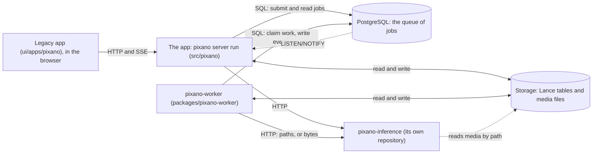

# Overall architecture

**Status:** Draft
**Owner:** @jrabary
**Last agreed change:** 2026-11-22
**Covers:** `docker-compose*.yml`, `.env.example`, `dockerfiles/`, `hatch_build.py`, `src/pixano/cli/`, `src/pixano/utils/`, and the list of packages under `packages/`

## Purpose and concepts

Pixano is an open-source data engine for physical AI: robots, vehicles and other machines that learn from what their sensors record. It takes in recordings from fleets, labs and simulators: video from several cameras at once, 3D point clouds, robot telemetry, images and text. It sorts, indexes and pre-annotates them with jobs and AI agents. People review the result. Pixano then publishes versions of a dataset that never change, so that a training or an evaluation can be run again on the same data.

This spec says what Pixano is made of, and how its parts reach each other.

**Most of this spec is a target.** A rule marked `(target)` says where the code goes, and the line `_Today:_` under it says where the code is ([SPEC-14](./README.md#rules)). A rule without the mark is true in the code today. The section [The repository today](#the-repository-today) describes the code as it is.

The words this spec uses:

- A **component** is a program that runs on its own. The target has five: `pixano-api`, `pixano-worker`, `pixano-mcp`, `pixano-inference` and PostgreSQL. Today there are four: `pixano-mcp` does not exist, and `pixano-api` is the app that `pixano server run` starts.
- A **plane** is a group of components with one role. Pixano has six, listed below.
- A **provider** is a server of models that Pixano calls: a `pixano-inference` server, or an external one (vLLM, OpenAI, Gemini, Ollama, any HTTP endpoint).
- A **snapshot** is one version of a dataset. It never changes once it is published.
- A **manifest** is a file written beside the tables of a snapshot. It describes the snapshot, so that a program can read it without PostgreSQL.
- A **write lease** is the right to write to one dataset. One writer holds it at a time, for a limited time.
- A **fencing token** is a number that only grows. Each lease gets a higher one, and a write that carries an old one is refused. A writer that lost its lease can then no longer write.
- A **read-through cache** keeps a copy of what was read, to answer faster the next time. It can be lost at any moment.

The six planes:

1. **Presentation and SDK.** The user interface, the `pixano` command line, and the Python SDK that data pipelines and training loaders use. The interface is the legacy app (`ui/apps/pixano`), served by `pixano-api`, until a desktop application, built in its own repository, can replace it.
2. **Agents.** `pixano-mcp`, a Model Context Protocol server. An AI agent uses it to search, sort and inspect datasets and to run jobs, with the same rights as a person.
3. **Control and queries.** `pixano-api` and PostgreSQL. They hold everything that is not the data itself: the catalogue of datasets, the pointer to each one's current snapshot, lineage, the queue of jobs, the registry of workers, the write leases, the providers, the accounts and their rights, the audit log.
4. **Execution.** `pixano-worker`. It runs every long job: import, export, compaction, embeddings, detection, segmentation, video tracking, statistics, chains of jobs.
5. **Data.** Lance (LanceDB), on S3-compatible or POSIX storage. It holds the tables, the annotations, the vector indexes, the time series, the media and the manifests of the snapshots.
6. **Inference.** One or several providers. They serve the interactive tools and the jobs.

The same six planes run everywhere. Three kinds of deployment differ only by their configuration and their size:

- **A workstation:** one machine, with Docker Compose or plain processes.
- **A lab, possibly cut off from the internet:** a private network, a shared PostgreSQL, a NAS or MinIO, GPUs on site, a local single sign-on.
- **A cloud cluster:** several replicas of `pixano-api`, `pixano-worker` and `pixano-mcp` on Kubernetes, a managed PostgreSQL, S3 or GCS, GPU pools that grow and shrink.

## Rules

### Between the specs

**ARCH-1.** The spec of one part of Pixano (`DATA`, `API`, `JOB`, `IO`, `UI`, `INF`) MUST NOT contradict a rule of this spec. Where this spec has a target rule, the spec of the part describes what the code does today, and MUST NOT decide against the target.

_Why:_ the parts are designed one at a time, by different people and agents. One spec has to hold what they share.

### Topology and deployment

**ARCH-2 (target).** Every deployment MUST run all the planes: `pixano-api` with PostgreSQL, at least one `pixano-worker`, the Lance storage, and the providers it is configured with. Pixano MUST NOT offer a mode without PostgreSQL and a worker.

_Why:_ a second, smaller mode needs its own code for jobs, locks and metadata. The two modes drift apart, and what works on a laptop stops telling what works in production.

_Today:_ the app runs alone: `pixano init`, then `pixano server run`. Without `PIXANO_DATABASE_URL`, the jobs routes answer 503 and an import reports that no queue is configured (`src/pixano/api/routers/jobs.py`, `src/pixano/api/routers/data_io.py`). Import and export need no PostgreSQL.

**ARCH-3.** Every link between two components MUST be configured from outside the code: an address, and credentials when the link needs them. A component MUST NOT assume that another one runs on the same host, in the same process or in a container.

_Why:_ the same code and the same images must run on a laptop, in a lab and on Kubernetes, started by Compose, by Kubernetes or by hand.

**ARCH-4 (target).** Every component MUST start, authenticate its users, serve datasets, run jobs and call a local provider without any access to the public internet.

_Why:_ robotics labs and industrial sites often run on closed networks, and must keep their data on site.

_Today:_ nothing checks it. The code reaches the internet at least on request: for a Hugging Face import (`src/pixano/datasets/io/formats/lerobot/hub.py`) and for the external providers (`src/pixano/inference/providers/`).

### Control plane

**ARCH-5 (target).** PostgreSQL MUST be the only store of the state of the control plane: the catalogue of datasets, the pointer to each current snapshot, lineage, the jobs and their events, the registry of workers, the write leases, the providers, the accounts, their rights and the audit log. SQLite MUST NOT hold jobs or metadata at run time.

_Why:_ with one transactional store, the replicas of the API, the command line and the workers cannot disagree on the state.

_Today:_ PostgreSQL holds the queue of the worker's jobs and nothing else: the six tables of the schema `pixano_jobs` (`packages/pixano-worker/src/pixano_worker/sql/schema.sql`). Import and export jobs are in a SQLite file, `<data_dir>/.pixano/jobs.sqlite` (`src/pixano/datasets/io/jobs.py`, `docs/specs/data-import-export.md`). The providers are in the memory of the app. There is no catalogue, no account, no right and no audit log.

**ARCH-6 (target).** `pixano-api` MUST be the only component that connects to PostgreSQL, and it owns the schema. `pixano-worker`, `pixano-mcp`, the interface, the command line and the SDK MUST NOT hold PostgreSQL credentials or send SQL to it.

_Why:_ one owner means one place for the SQL and for the migrations. The credentials of the database stay off remote GPU machines, and the control plane can be migrated without breaking the workers.

_Today:_ the worker connects to PostgreSQL, claims its work with SQL and owns the schema. The app and the command line connect too, to submit jobs and to read them (`docs/specs/backend-processing.md` §2 to §4: "The worker shares nothing with the API but PostgreSQL and the storage"). That stays the rule for the worker until this mark is removed.

**ARCH-7 (target).** Every change to the schema of the control plane MUST go through a migration that is versioned and only goes forward. The schema MUST NOT be dropped and recreated to change it.

_Why:_ in production, PostgreSQL holds what cannot be rebuilt: the catalogue, lineage, the rights, the audit log and the history of the jobs.

_Today:_ there is no migration engine, on purpose. A changed schema is wiped and recreated, and `SCHEMA_VERSION` makes a worker refuse a stale one (`docs/specs/backend-processing.md` §5, which plans the runner for the day the database holds something that cannot be rebuilt).

**ARCH-8 (target).** `pixano-api` MUST NOT keep shared state in the memory of one process: no map of providers, no registry of jobs, no thread that runs a job. Any replica MUST be able to answer any request.

_Why:_ state in one process is lost at a restart, and the other replicas do not know it.

_Today:_ the providers are in the settings of the process (`Settings.inference_providers`, `src/pixano/api/settings.py`), and tracking jobs in a map in memory (`TRACKING_JOB_REGISTRY`, `src/pixano/api/routers/inference.py`). Import and export run in threads of the app (`src/pixano/datasets/io/jobs.py`), and so does one embeddings path (`src/pixano/api/embeddings.py`).

**ARCH-9.** The events of the jobs MUST reach every replica of `pixano-api` through PostgreSQL `LISTEN/NOTIFY`, or through a shared bus that does the same.

_Why:_ the replica that holds a browser's connection is rarely the one where the event happened.

**ARCH-10 (target).** `pixano-api` MUST reach PostgreSQL through a pool of connections with a fixed maximum. It MUST NOT open a connection for each request.

_Why:_ a team at work sends many requests at once, and one connection for each exhausts PostgreSQL.

_Today:_ each request that needs the queue opens its own connection (`connect`, `src/pixano/api/jobs/enqueue.py`). The worker has a pool.

### Data plane

**ARCH-11.** The tables of a dataset (records, views, entities, annotations, embeddings) MUST be stored in Lance (LanceDB), on POSIX or S3-compatible storage.

_Why:_ one versioned format holds the structured data and the vectors, and a training cluster reads it straight from the storage.

**ARCH-12 (target).** The media of a dataset MUST be stored in Lance too, in blob columns that are read by byte range, so that a scan of the metadata or a compaction does not rewrite the media. Pixano MUST NOT need a separate store of media files, or a translation of media paths between components. A dataset MAY refer to media that stay outside it, by an immutable `https://` or `s3://` URI.

_Why:_ media kept beside a dataset get out of step with it: files are orphaned, mounts break. Inside Lance, a snapshot is whole, and a video can still be read from any point.

_Today:_ a view holds its bytes in the dataset (`embed`, the default import mode) or the path of a file outside it (`docs/specs/backend-processing.md` §13). In the Compose stack these files are one directory, `PIXANO_MEDIA_DIR`, and the worker and the inference each declare the root under which they see it (`PIXANO_MEDIA_ROOT`, `PIXANO_INFERENCE_MEDIA_ROOT`; §2: "the worker translates between them").

**ARCH-13 (target).** Every published snapshot MUST have a manifest, written beside its Lance tables, that describes it whole. A training loader (PyTorch, JAX, Lance) MUST be able to read a snapshot from the storage without PostgreSQL.

_Why:_ training clusters read the storage directly, at full speed, and often cannot reach the control plane.

_Today:_ there is no snapshot and no such manifest. A dataset is one set of Lance tables that changes in place. (`src/pixano/datasets/io/manifest.py` is the journal of an import, not the description of a dataset.)

**ARCH-14 (target).** Every write to a dataset, from any process, MUST hold a write lease on that dataset, given by the control plane with a fencing token, and MUST be committed against that token. A file lock, or a lock that does nothing on S3, MUST NOT be what protects a dataset.

_Why:_ a file lock fails on NFS and does not exist on S3, so two writers corrupt a dataset without a word. A lease in PostgreSQL works the same on a disk, on NFS and on S3, and frees itself when its holder dies.

_Today:_ a file lock beside the dataset, skipped for an S3 path (`dataset_mutation_lock`, `src/pixano/datasets/locking.py`). In a worker, one thread lock per dataset (`docs/specs/backend-processing.md` §12).

**ARCH-15 (target).** Opening, listing or reading a dataset MUST NOT write to it: no change of schema, no migration of the storage layout, no table created. Each of these is an explicit write, under a write lease.

_Why:_ a read that writes creates races when an API, a command line and a worker of different versions open the same storage, and it fails on read-only storage.

_Today:_ opening a dataset of an older layout migrates it in place (`_migrate_storage`, `src/pixano/datasets/dataset.py`), and resolving an annotation or entity resource creates its missing table and rewrites `info.json` on the fly (`BaseService.resolve_table`, `src/pixano/api/service.py`).

**ARCH-16 (target).** The data plane MUST hold the data of physical AI without flattening it: video from several cameras, kept as video and read by time window; 3D point clouds with the calibration of their sensors; robot states and actions as time series at their own rate.

_Why:_ a robot episode is several sensors in step. Video cut into one row per frame does not scale, and a dataset without its time series cannot train a policy.

_Today:_ view types exist for a video, the frames of a sequence, a calibrated image and a calibrated point cloud (`src/pixano/schemas/views/`), and time series have their routes (`src/pixano/api/routers/timeseries.py`). What is still flattened, at import or in storage, is not measured yet: it is an open question below.

**ARCH-17.** Pixano MUST accept an import or export format as a plug-in, found through the Python entry points of the group `pixano.formats`.

_Why:_ a lab adds the format of its robots without changing the core.

**ARCH-18 (target).** Every automated write, import and export MUST keep where the data comes from. An export or a training view MUST be addressed by a snapshot and a filter on the review status, so that a training or an evaluation can be run again on exactly the same data.

_Why:_ evaluating a robot and auditing its safety means tracing a trained policy back to the exact data, and to who or what produced each annotation.

_Today:_ an annotation carries its source and its review status, and an export can filter on that status (`src/pixano/schemas/annotations/`, `docs/specs/writing-a-job-kind.md`). There is no snapshot: an export reads the dataset as it is at that moment.

### Media, cache and the way to the inference

**ARCH-19 (target).** `pixano-api` MUST serve media (images, thumbnails, video by HTTP Range, point clouds) and costly summaries through a read-through cache with a fixed maximum size, whose keys include the version of the data. The cache MUST NOT be the only place where anything is kept: when a replica or the cache is lost, everything is read again from Lance.

_Why:_ the same thumbnails, video positions and overviews are asked again and again. A cache absorbs them without giving the API a state of its own, and lets a desktop client cache too.

_Today:_ there is no cache with a fixed size and keys by version. The bytes of a view are answered with `Cache-Control: public, max-age=3600` and an `ETag` (`src/pixano/api/routers/views.py`).

**ARCH-20 (target).** A change that makes cached data stale MUST reach every replica of `pixano-api`, the same way as the events of the jobs (ARCH-9).

_Why:_ a replica that was not told keeps answering with the old data.

_Today:_ the caches of the app are told of a change inside one process only (`Dataset.invalidate_caches`, `src/pixano/datasets/dataset.py`).

**ARCH-21 (target).** Media MUST reach a provider as raw bytes or as a reference: a signed URL that expires soon, for an interactive call; a stream from `pixano-worker` straight to `pixano-inference`, for a job; or a reference to a Lance blob or to an external URI. An image or a video MUST NOT be sent as base64 text inside a JSON body. The adapter of an external provider that cannot reach a private URL MAY encode a bounded input itself.

_Why:_ base64 in JSON multiplies the memory a call needs, and the heavy traffic of the jobs must not pass through `pixano-api`.

_Today:_ paths are preferred and bytes are the fallback: a view stored inside the dataset is sent as a data URI, that is base64 (`docs/specs/backend-processing.md` §2 and §13, `src/pixano/inference/media.py`).

### Execution plane

**ARCH-22.** A job of the queue MUST run in `pixano-worker`, never in the process of `pixano-api`.

_Why:_ a job over tens of thousands of images must not slow down the annotation interface.

**ARCH-23 (target).** Every long or heavy operation on a dataset MUST be a job of the queue: import, export, compaction, embeddings, detection, segmentation, video tracking, statistics, and chains of jobs. None MUST run in a request handler or in a thread of `pixano-api`.

_Why:_ heavy work in the API slows the interface down, cannot be spread over several machines, and is lost at a restart.

_Today:_ import and export run in threads of the app, with their own SQLite store (`src/pixano/datasets/io/jobs.py`). So does one embeddings path (`src/pixano/api/embeddings.py`). `pixano data optimize` runs in the command line (`src/pixano/cli/data.py`).

**ARCH-24 (target).** `pixano-worker` MUST get its work from `pixano-api`, over an HTTP API that is authenticated and versioned, with a service token. It MUST NOT listen on any port.

_Why:_ a worker that only calls out runs behind a firewall or a NAT, on a GPU machine or on a lab bench, and takes work only when it is ready for it.

_Today:_ the worker gets its work from PostgreSQL, with SQL (`docs/specs/backend-processing.md` §3). It listens on no port already (`packages/pixano-worker/src/pixano_worker/healthcheck.py`).

**ARCH-25 (target).** `pixano-worker` MUST find its job kinds through the Python entry points of the group `pixano.job_kinds`, with a typed contract, as `pixano-inference` finds its model plug-ins.

_Why:_ a team adds the job its robots need without changing the worker.

_Today:_ the kinds are registered in code (`default_registry`, `packages/pixano-worker/src/pixano_worker/kinds/__init__.py`; `docs/specs/writing-a-job-kind.md`).

**ARCH-26 (target).** Every worker MUST send a heartbeat and declare what it can do: its job kinds, its hardware, the storage and the providers it reaches. The control plane MUST give a piece of work only to a live worker that can do it.

_Why:_ in a pool of different machines, a worker that claims a job it cannot run blocks that job.

_Today:_ a worker declares its kinds at startup, in the table `job_kinds`, and claims the pending chunks in the order of their ids, whatever their kind (`packages/pixano-worker/src/pixano_worker/sql/schema.sql`, `packages/pixano-worker/src/pixano_worker/queue.py`). There is no registry of workers.

**ARCH-27 (target).** The planning of a job and the execution of each of its chunks MUST be fenced by tokens that only grow.

_Why:_ a planner whose lease expired must not run a destructive preparation again, against the planner that took over.

_Today:_ the write of a chunk is fenced by its `attempts` counter (`packages/pixano-worker/src/pixano_worker/sql/schema.sql`). Planning runs under a lease and a time limit (`docs/specs/backend-processing.md` §10 and §12), with no fencing token: a planner whose lease lapsed can still interfere with the planner that took over, or run `prepare` late (`docs/specs/backend-processing.md` §20.2).

**ARCH-28 (target).** The control plane MUST share the workers fairly between the jobs, and MUST cap the calls in flight for each model.

_Why:_ one large job must not starve the small ones or the interactive tools, and a model server has a limit of its own.

_Today:_ the chunks are claimed in the order of their ids (`packages/pixano-worker/src/pixano_worker/queue.py`). There is no cap per model: `docs/specs/backend-processing.md` §6 names it as the subject of step 4.

### Inference plane

**ARCH-29 (target).** A deployment MUST be able to configure several providers: one or more pools of `pixano-inference`, and external providers. They MUST be stored in the control plane, and be the same for `pixano-api` and for `pixano-worker`.

_Why:_ a team mixes its own GPUs with external models. With one registry, the interactive tools and the jobs use the same models, and the configuration survives a restart.

_Today:_ the app keeps its providers in memory. One is connected at startup with `--pixano-inference-url`, others at run time through `POST /inference/connect` (`src/pixano/api/routers/inference.py`). The worker reads one address, `PIXANO_INFERENCE_URL`. The external providers (Gemini, Ollama, OpenAI) exist in the app only (`src/pixano/inference/providers/`).

**ARCH-30 (target).** Every call from `pixano-api` or `pixano-worker` to a provider MUST carry the credentials configured for it, in a header (`X-API-Key` or `Authorization`).

_Why:_ a shared inference server asks for a key, and a call without it fails.

_Today:_ the worker is given a key (`PIXANO_INFERENCE_API_KEY`, `docker-compose.yml`). The app started with `--pixano-inference-url` has none: a key reaches it only through `POST /inference/connect` (`src/pixano/cli/server.py`).

**ARCH-31 (target).** Registering a provider, or changing its endpoint, MUST need the rights of an administrator, or be done by the configuration of the deployment. It MUST NOT be an open route, and a secret MUST NOT travel in the query string of a URL.

_Why:_ an open route that makes the server call any address is a way into the private network, and a key in a URL ends up in logs and in histories.

_Today:_ `POST /inference/connect` is open to whoever reaches the app, and takes `api_key` in the query string (`src/pixano/api/routers/inference.py`).

**ARCH-59.** `pixano-api` MUST start, be ready and serve everything that needs no model when the inference cannot be reached.

_Why:_ browsing, annotating by hand, importing and exporting need no model. An outage of the inference must not take the rest of Pixano out of service.

### Agents

**ARCH-32 (target).** Pixano MUST provide a Model Context Protocol server, `pixano-mcp`. It speaks Streamable HTTP for remote agents, and MAY speak stdio for local ones. Its tools and resources cover: finding datasets, filtering and semantic search, inspecting overviews and quarantined items, managing snapshots, running jobs.

_Why:_ sorting data, mining failure cases and running labelling campaigns with agents is core work for a data engine of physical AI.

_Today:_ `pixano-mcp` does not exist.

**ARCH-33 (target).** `pixano-mcp` MUST be a client of `pixano-api`, with a token scoped to a user or to a service. It gets the same rights, the same isolation of storage and the same audit log as a person. It MUST NOT reach PostgreSQL or Lance directly.

_Why:_ an agent that goes around the control plane goes around the rights, the leases and lineage.

_Today:_ `pixano-mcp` does not exist.

**ARCH-34 (target).** An MCP tool that writes, or that starts a computation, MUST require an explicit permission scope, and MUST support an approval, by a policy or by a person, before it acts.

_Why:_ an agent left alone can delete data or burn GPU hours.

_Today:_ `pixano-mcp` does not exist.

### Security

**ARCH-35 (target).** Every route of `pixano-api` and of `pixano-mcp`, except the liveness probes, MUST authenticate its caller with a token in a header, check its rights by role, and write to the audit log. A person signs in through OIDC, from a browser or from a desktop application (PKCE), and gets a bearer token. A worker, the command line, the SDK and an agent use a scoped API key.

_Why:_ a shared lab, a cloud deployment, agents and a desktop application all need an identity that can be checked, the least rights that do the job, and a trace of who did what.

_Today:_ there is no authentication. Every route answers whoever reaches the server.

**ARCH-36 (target).** A media route used by a `<video>` or an `` element MUST also accept a signed token that expires soon, so that no client depends on a browser cookie.

_Why:_ these elements cannot send a header, and a desktop application has no cookie of the same origin.

_Today:_ there is no authentication, so no token of any kind.

**ARCH-37 (target).** Turning authentication off MUST need an explicit flag, meant for local development and off by default, and MUST print a visible warning at startup.

_Why:_ a server that is open by default ends up open in production.

_Today:_ there is no authentication to turn off.

**ARCH-38 (target).** A route, of the API or for the workers, that takes a path or a URI for an import or an export MUST keep it inside the roots or the buckets configured for that, after `..` and symbolic links are resolved.

_Why:_ without it, a caller reads or writes any file the server can reach.

_Today:_ an upload is kept under the uploads root. But an import takes as its source any path that the server can read, and an export any destination it can write (`source` and `destination`, `src/pixano/api/routers/data_io.py`).

**ARCH-39 (target).** Every upload and every request body MUST have a size limit that the deployment can set.

_Why:_ without a limit, one request fills the disk or the memory.

_Today:_ no limit is set (`src/pixano/api/routers/data_io.py`).

**ARCH-40 (target).** A filter that comes from a caller MUST be validated or passed as a parameter. It MUST NOT be pasted into a SQL string.

_Why:_ a pasted filter is an injection.

_Today:_ filters are built as SQL strings, including caller query parameters pasted directly into `WHERE` clauses (`f"record_id = '{record_id}'"`, `logical_name`, `where` in `src/pixano/api/routers/views.py`; `f"split='{split}'"` in `src/pixano/datasets/exporters/dataset_exporter.py`; `to_sql_list` in `src/pixano/datasets/io/reader.py`).

**ARCH-41 (target).** Every image (`pixano-api`, `pixano-worker`, `pixano-inference`, `pixano-mcp`) MUST run as a dedicated user that is not root.

_Why:_ a container that runs as root breaks the rules of most clusters, and leaves files owned by root on shared storage.

_Today:_ none of the three Dockerfiles sets a user, so the images run as root (`dockerfiles/Dockerfile`, `dockerfiles/Dockerfile.source`, `packages/pixano-worker/Dockerfile`).

**ARCH-42 (target).** A secret MUST NOT be written in an image, in the arguments of a process, in a URL or in a log line.

_Why:_ each of these is read by more people than the secret is meant for.

_Today:_ `pixano server run` takes the S3 keys as options (`--aws-secret-key`, `src/pixano/cli/server.py`), and `POST /inference/connect` takes a key in its URL.

### Repository, packages and frontend

**ARCH-43 (target).** This repository MUST hold every Python component: `pixano` (the SDK and the command line), `pixano-api`, `pixano-worker`, `pixano-inference` with its model plug-ins, and `pixano-mcp`. It also holds `specs/` and the docs for users (`docs-astro/`).

_Why:_ a contract between two components then changes in one pull request, with its spec and its docs. No Compose file has to build from a checkout beside this one.

_Today:_ `pixano`, with the API inside it, `pixano-worker`, `specs/` and `docs-astro/` are here. `pixano-inference` is a repository of its own: Pixano depends on its published package (`pyproject.toml`), and the Compose file builds its image, unmodified, from a checkout beside this one (`docker-compose.inference.yml`). `pixano-mcp` does not exist.

**ARCH-44 (target).** Each component MUST be delivered as its own OCI image, and each Python package MUST have its own `pyproject.toml` and its own distribution on PyPI.

_Why:_ a deployment then takes only the parts it runs, and each one builds fast.

_Today:_ two packages, `pixano` (with the API) and `pixano-worker`, and two images, the app's and the worker's (`dockerfiles/`, `packages/pixano-worker/Dockerfile`). Neither the worker's package nor its image is published yet (`docs/releases/0.9-followups.md`).

**ARCH-45 (target).** The build of the `pixano` package MUST NOT call Node or pnpm, and its wheel MUST NOT contain frontend files.

_Why:_ a frontend build of several gigabytes must not be what breaks the wheel of the Python SDK.

_Today:_ the build hook of the wheel runs pnpm and builds both frontends into it (`hatch_build.py`). `pip install pixano` then gives a server with its interface.

**ARCH-46 (target).** In CI, a heavy job (the tests of the model plug-ins, the legacy app, the Docker images) MUST run only when the paths it covers change, and the checks that a pull request requires MUST keep the same names whatever runs.

_Why:_ in a repository of several components, a contributor must not wait for the tests of what they did not touch. And a required check that does not report blocks the pull request.

_Today:_ each workflow ends in one job that gathers the others (`Backend`, `Frontend`, and the one of `docker.yml`). The path filters apply to a push only: a pull request runs every job (`.github/workflows/`).

**ARCH-47.** `pixano` and `pixano-worker` MUST import nothing from `pixano-inference` but `pixano_inference.schemas` and `pixano_inference.client`.

_Why:_ the app, and a worker without a GPU, must not pull Ray Serve or a model framework.

**ARCH-48 (target).** `pixano.schemas` MUST hold the schemas and nothing else: Pydantic models and Lance models, with the types and the names they need. It MUST NOT import a library that no model is made of: OpenCV, pycocotools, FastAPI, anything of the interface.

_Why:_ the schemas are what every component and every pipeline imports, also on a machine with no display.

_Today:_ importing `pixano.schemas` imports OpenCV and pycocotools: `src/pixano/schemas/views/image.py` imports `src/pixano/features/utils/image.py`, which imports both. The models also carry code that is not a schema, and that imports Pillow, NumPy and shortuuid: opening an image, converting a mask, projecting a box, making an identifier.

**ARCH-49 (target).** `pixano-inference` MUST NOT import `pixano`.

_Why:_ the model server must install and run on its own.

_Today:_ `pixano-inference` is not in this repository (ARCH-43).

**ARCH-50 (target).** `pixano-mcp` MUST import from `pixano` only its HTTP client and its wire schemas.

_Why:_ it is a client of the API (ARCH-33), and must not carry the API's internals, PostgreSQL or Lance.

_Today:_ `pixano-mcp` does not exist.

**ARCH-51 (target).** CI MUST check the import rules ARCH-47 to ARCH-50.

_Why:_ an import boundary that nothing checks is crossed within weeks. A repository of several packages must not become one program.

_Today:_ nothing checks imports.

**ARCH-52.** `pixano-api` MUST serve the legacy app (`ui/apps/pixano`), until the desktop application can replace it.

_Why:_ annotation work must not stop while the new interface is built.

**ARCH-53 (target).** This repository MUST hold one frontend only, the legacy app. The new UI (`ui/apps/web`) and the switch between two interfaces (`ACTIVATE_UI_V1_0` and its cookie) MUST NOT be in it.

_Why:_ the new interface is rebuilt as a desktop application, in a repository of its own. Two interfaces in one wheel double the build, and the switch ties the API to a cookie.

_Today:_ `ui/apps/web` is here, and it is built into the wheel. The server shows it when `ACTIVATE_UI_V1_0` is true and the browser asked for it with the cookie `pixano_ui_version` (`src/pixano/api/serve.py`).

**ARCH-54 (target).** `pixano-api` MUST NOT depend on the interface that calls it. Every feature MUST be reachable through an HTTP or SSE endpoint that is documented and versioned. The allowed origins MUST be set by configuration. No feature MUST depend on a cookie of the same origin, or on a path of the machine where the server runs.

_Why:_ a desktop application on an engineer's machine must work against a Pixano on that machine, in the lab or in the cloud.

_Today:_ the allowed origins are set by configuration already (`cors_origins`, `src/pixano/api/main.py`). The switch between interfaces uses a cookie, an import takes a path of the server as its source, and the paths of the routes carry no version.

### Observability

**ARCH-55 (target).** Every long-running component MUST answer two questions apart: "is the process alive" (`/health/live`, or a heartbeat), and "can it serve", which tests what it depends on (`/health/ready`).

_Why:_ a route that always answers `ok` hides a broken dependency, and defeats the readiness probes of Kubernetes.

_Today:_ the app has one route, `/health`, that tests nothing (`src/pixano/api/main.py`). The worker has a heartbeat file, read by `pixano_worker.healthcheck`.

**ARCH-56 (target).** Every component MUST write its logs as JSON, with the identifiers that tie the lines together: the request, the job, the worker, the dataset.

_Why:_ plain text logs from several replicas cannot be searched or joined.

_Today:_ the logs are plain text, and a request has no identifier.

**ARCH-57 (target).** Every component MUST export OpenTelemetry traces and Prometheus metrics.

_Why:_ a slow request crosses the API, a worker and a provider. Without traces, nobody can say where the time went.

_Today:_ none does.

**ARCH-58 (target).** On `SIGTERM`, every component MUST stop within a bounded time, finish or hand back its work, and release its leases.

_Why:_ a cluster stops containers all day. A component that dies with a lease in hand blocks the work until the lease expires.

_Today:_ the worker handles `SIGTERM` and `SIGINT` (`packages/pixano-worker/src/pixano_worker/__main__.py`). The app has no handling of its own.

## The repository today

This section describes the code as it is. It changes each time a target rule loses its mark.

| Component                   | Where it lives                                                                | Started by                     | What it reaches, and how it is told                                                                                                                                                            |
| --------------------------- | ----------------------------------------------------------------------------- | ------------------------------ | ---------------------------------------------------------------------------------------------------------------------------------------------------------------------------------------------- |
| The app (API and interface) | `src/pixano/`, the package `pixano`                                           | `pixano server run <data_dir>` | PostgreSQL (`PIXANO_DATABASE_URL`, optional), the inference (`--pixano-inference-url`), the storage (the data directory, or S3)                                                                |
| `pixano-worker`             | `packages/pixano-worker/`, a package with its own lockfile, built on `pixano` | `pixano-worker`                | PostgreSQL (`PIXANO_DATABASE_URL`), the inference (`PIXANO_INFERENCE_URL`, `PIXANO_INFERENCE_API_KEY`), the storage (`PIXANO_LIBRARY_DIR`, `PIXANO_MEDIA_ROOT`, `PIXANO_INFERENCE_MEDIA_ROOT`) |
| PostgreSQL                  | The image `postgres:16`, in `docker-compose.yml`                              | Compose, or by hand            | Nothing                                                                                                                                                                                        |
| The inference               | The repository `pixano-inference`; `docker-compose.inference.yml` builds it   | Compose, or by hand            | The media, under the root it declares                                                                                                                                                          |

- **The stack.** `docker-compose.yml` starts PostgreSQL, the app and the worker. `docker-compose.inference.yml` adds an inference built on the machine. `docs/running-by-hand.md` runs the same four components as plain processes, with the same variables. `.env.example` lists every address.
- **The repository.** `src/pixano/` holds the backend: `api`, `cli`, `datasets`, `inference`, `features`, `schemas`, `utils`. `packages/pixano-worker/` holds the worker. `ui/` is a pnpm and Turbo workspace with two apps. `docs-astro/` holds the docs for users, and `specs/` the specs.
- **The two frontends.** `ui/apps/pixano` is the legacy app, and the one the server serves. `ui/apps/web` is the new UI: the server shows it only when `ACTIVATE_UI_V1_0` is true and the browser asked for it. The two apps share no code.
- **The wheel.** `uv build` runs `hatch_build.py`. It runs `pnpm install --frozen-lockfile`, then builds the legacy app, then the new UI. Both builds go into the wheel, under `pixano/api/legacy_dist` and `pixano/api/dist`. An editable install skips the hook.
- **The command line.** The package `pixano` has one console script, `pixano` (`pixano.cli:main`): `pixano init`, `pixano server run`, and `pixano data` with `import`, `export`, `formats`, `optimize`, `jobs` and `fix-creation-dates`. `pixano dataset` is another name for `pixano data`. The package `pixano-worker` has one too, `pixano-worker` (`pixano_worker.__main__:main`).

## The target

```mermaid
flowchart TB
    subgraph Presentation["1. Presentation and SDK"]
        DESKTOP["Desktop application (target, its own repository)"]
        LEGACY["Legacy app (ui/apps/pixano), served by pixano-api until the desktop application replaces it"]
        CLI["pixano command line and Python SDK"]
        PY["Training loaders (PyTorch, JAX)"]
    end

    subgraph Repo["The pixano repository"]
        subgraph Agentic["2. Agents"]
            MCP["pixano-mcp (packages/pixano-mcp): Streamable HTTP, stdio"]
        end

        subgraph Control["3. Control and queries"]
            API["pixano-api (src/pixano/api): several replicas, no state"]
            CACHE[("Read-through cache: can be lost")]
            PG[("PostgreSQL: catalogue, snapshots, jobs, leases, workers, providers, rights, audit")]
            API <-->|"hit or miss"| CACHE
            API <-->|"SQL, LISTEN/NOTIFY"| PG
        end

        subgraph Execution["4. Execution"]
            W_IO["pixano-worker: import, export, formats"]
            W_GPU["pixano-worker: embeddings, detection, segmentation, tracking"]
            W_EDGE["pixano-worker on a lab machine: calls out only"]
        end

        subgraph Inference["6. Inference"]
            PINF["pixano-inference (packages/pixano-inference): GPU pools, model plug-ins"]
        end
    end

    subgraph External["Outside"]
        AGENTS["AI agents"]
        EXT["External providers (vLLM, OpenAI, Gemini, Ollama)"]
    end

    subgraph Data["5. Data"]
        LANCE[("Lance on S3, MinIO or POSIX: tables, vectors, time series, media, manifests")]
    end

    DESKTOP -->|"HTTPS, SSE, media by Range (bearer token, signed URL)"| API
    LEGACY -->|"HTTPS, SSE, media by Range"| API
    CLI -->|"HTTPS (bearer token or API key)"| API
    AGENTS --> MCP
    MCP -->|"HTTPS (scoped token)"| API

    PY -.->|"reads snapshots straight from the storage"| LANCE

    API <-->|"reads on a cache miss, writes under a lease"| LANCE
    API -->|"interactive calls (key, signed media URL)"| PINF
    API -->|"interactive calls (key)"| EXT

    W_IO -->|"HTTPS: claim, heartbeat, lease"| API
    W_GPU -->|"HTTPS: claim, heartbeat, lease"| API
    W_EDGE -->|"HTTPS: claim, heartbeat, lease"| API

    W_IO <-->|"reads, writes under a lease"| LANCE
    W_GPU <-->|"reads, writes under a lease"| LANCE
    W_GPU -->|"batch calls (key, bytes or blob reference)"| PINF
    W_GPU -->|"batch calls (key)"| EXT
```

| Plane                     | What is delivered                                | Where it lives                                                            | Talks to                                                       |
| ------------------------- | ------------------------------------------------ | ------------------------------------------------------------------------- | -------------------------------------------------------------- |
| Presentation (target)     | The desktop application                          | Its own repository, rebuilt from `ui/apps/web`                            | `pixano-api`                                                   |
| Presentation (until then) | The legacy app, inside the image of `pixano-api` | `ui/apps/pixano/`                                                         | `pixano-api`                                                   |
| SDK and command line      | The package `pixano`, with no interface in it    | `src/pixano/{schemas,datasets,inference,cli,utils}/`                      | `pixano-api`; Lance, to read snapshots                         |
| Agents                    | `pixano-mcp`: an image and a package             | `packages/pixano-mcp/` (does not exist yet)                               | `pixano-api`                                                   |
| Control and queries       | `pixano-api`: an image, with its cache           | `src/pixano/api/`                                                         | PostgreSQL (it alone), the cache, Lance, the providers         |
| Execution                 | `pixano-worker`: an image and a package          | `packages/pixano-worker/`                                                 | `pixano-api`, Lance, the providers                             |
| Inference                 | `pixano-inference`: an image and packages        | `packages/pixano-inference/` (today in the repository `pixano-inference`) | Nothing: it receives bytes, signed URLs or references to blobs |

## Open questions

About the target:

- **Lance blobs read by `pixano-inference`.** For batch jobs over terabytes, should `pixano-inference` read a blob of Lance by its address (dataset, table, row, version) straight from the storage? Or is a stream from `pixano-worker`, with references to external URIs, enough?
- **Where the cache of the API lives.** Does it start in the process, or on a local disk, with the standard HTTP headers for a proxy and for the desktop client? Or does it also need a shared store (Redis, Valkey) for the summaries, when there are several replicas?
- **Release tags.** Once `pixano-inference`, `pixano-worker` and `pixano-mcp` are published from this repository, does each package get its own tag (`pixano-vX.Y.Z`, `pixano-worker-vX.Y.Z`), or do all share one version?
- **Several tenants.** Do the first rights apply to projects and datasets inside one organization, or does Pixano isolate tenants from the start (PostgreSQL schemas or rows, S3 prefixes, queues of workers)?
- **Lance Namespace.** Should the control plane also expose a `lance-namespace` REST catalogue, so that Spark, Ray and DuckDB open a Pixano dataset by its URI?
- **Video codecs a browser cannot play.** The desktop application decodes more codecs. For the legacy app, are AV1, HEVC and the raw images of sensor bags transcoded by a job, which stores an H.264 copy beside the raw media in Lance? Or are they left to the desktop application?
- **Starting everything on one machine.** Once the mode without PostgreSQL is gone (ARCH-2), what is the one command that starts a local Pixano: `docker compose up`, or a `pixano stack up`?
- **The air gap.** How is ARCH-4 checked: by a CI job that runs the stack with no way out to the internet?
- **Parity.** What must the desktop application do before it replaces the legacy app (ARCH-52), and who says that it does?
- **What is flattened today.** Which data does the code still flatten, at import or in storage (ARCH-16)? The answer is a measurement, to be made with the `DATA` spec.
- **The code that the models carry.** Where do the methods that are not a schema go, once `pixano.schemas` holds schemas only (ARCH-48): opening an image, converting a mask, projecting a box? They are part of the Python API today. The answer comes with the `DATA` spec.
- **The worker without the inference.** Does ARCH-59 hold for `pixano-worker` too? Today it refuses to start when `PIXANO_INFERENCE_URL` is not set (`packages/pixano-worker/src/pixano_worker/config.py`), also to run the kinds that call no model.

Details that this spec leaves to the spec of a part:

- `DATA` and `API`: what a person's save does when it meets a write lease (ARCH-14). The proposal is a short, bounded wait, then a 409.
- `API`: the cache headers of the media (`ETag`, `Cache-Control`), and how the version of the API appears in the routes (ARCH-19, ARCH-54).
- `JOB`: the routes of the worker API, and the shape of a claim, a heartbeat and a lease (ARCH-24 to ARCH-28). The proposal is a group of routes under `/internal/v1/worker/`.
- `INF`: how bytes reach `pixano-inference` (ARCH-21). The proposal is a multipart route, `/binary`.
- `IO`: which formats Pixano ships, and in which order: LeRobot v2 and v3, MCAP and ROS 2 bags, RLDS and HDF5, simulator rollouts, beside COCO and Pixano JSONL (ARCH-16, ARCH-17).

## Decision log

- 2026-11-22: first version. The target architecture in six planes, with the rules that the code already follows, and the target rules marked (`ARCH-1` to `ARCH-58`) ([#866](https://github.com/pixano/pixano/pull/866)).
- 2026-11-22: `pixano.schemas` holds schemas only, Pydantic and Lance models (ARCH-48). `pixano-api` starts, is ready and serves what needs no model when the inference cannot be reached (ARCH-59) ([#867](https://github.com/pixano/pixano/pull/867)).
