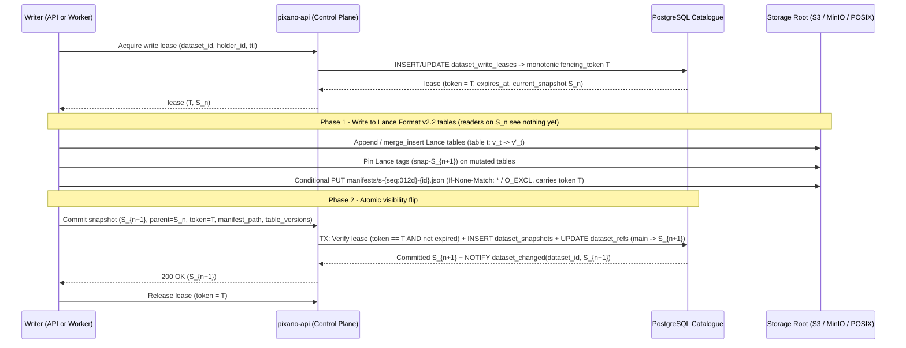
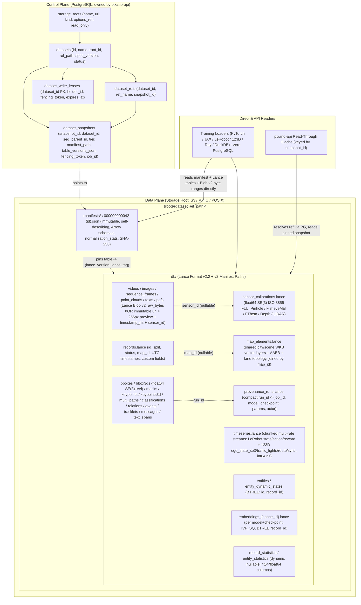

# Data model and database

**Status:** Draft
**Owner:** @jrabary
**Last agreed change:** 2026-11-24
**Covers:** `src/pixano/schemas/`, `src/pixano/features/`, `src/pixano/datasets/` except `io/`

## Purpose and concepts

This spec defines Pixano's data model, its LanceDB tables, its on-disk and object-storage layout, its versioning and concurrency rules, and its schema boundaries.

Pixano stores datasets for physical AI alongside standard computer vision and multimodal workloads. The **number-one design priority** of this data model is lossless, large-scale support — load, annotate, query, export, and train without flattening data or duplicating media — for four canonical formats:

1. **LeRobot v3.0** — embodied robotics and Vision-Language-Action (VLA) episodes with multi-camera random-access MP4 streams, multi-channel state/action/scalar telemetry, language tasks, and dataset-level normalization statistics.
2. **123D (`py123d`)** — multi-modal autonomous driving logs with asynchronous native-rate cameras (Pinhole, Fisheye MEI, F-Theta, Depth), multi-LiDAR/Radar sweeps, `float64` SE(3) ego dynamics, 3D oriented boxes with velocity, traffic light states, routes, and shared city-wide HD vector maps.
3. **COCO** — standard 2D computer vision images, categories, bounding boxes, RLE/polygon masks, and keypoints.
4. **Pixano JSONL v2** — Pixano's normative multimodal interchange format across images, multi-view records, videos, sequence frames, text, VQA conversations, and 3D scenes.

**Part of this spec describes the code today, and part is a target.** A rule marked `(target)` says where the data layer goes, and the line `_Today:_` under it states what the code does instead ([SPEC-14](./README.md#rules)). A rule without the mark is true in the code today. This spec obeys every rule of [`specs/architecture.md`](./architecture.md) ([ARCH-1](./architecture.md#between-the-specs)).

The words this spec uses:

- A **record** is the logical unit of a dataset (`Record`, table `records`): one image (COCO), one robot episode (LeRobot v3), one driving log or scene (123D), or one multimodal item (Pixano JSONL).
- A **record component** is a row attached to a record by `record_id` (`RecordComponent`): a view, entity, dynamic state, annotation, time-series chunk, embedding, or statistic.
- A **view** is a visual, textual, document, or 3D sensor observation belonging to a record (`View`): `Image`, `CalibratedImage`, `SequenceFrame`, `Video`, `PointCloud`, `CalibratedPointCloud`, `PointCloudFrame`, `Text`, or `PDF`. Multiple logical views of the same family (such as six cameras) share one physical table and are separated by `logical_name`.
- An **entity** is a real-world object or agent tracked across views and frames of a record (`Entity`, table `entities`), optionally with time-varying attributes in `EntityDynamicState` (`entity_dynamic_states`).
- An **entity annotation** is a label or geometry attached to an entity (`EntityAnnotation`: `BBox`, `BBox3D`, `CompressedRLE`, `KeyPoints`, `KeyPoints3D`, `MultiPath`, `Classification`, `Relation`, `TextSpan`, `Tracklet`, and in target `Event`). An **entity group annotation** attaches to zero or more entities (`EntityGroupAnnotation`: `Message`).
- A **sensor calibration** is the static intrinsic projection model and `float64` SE(3) mounting transform of a sensor in a record (`sensor_calibrations`, target).
- A **map element** is a vector HD map primitive (lane, crosswalk, intersection, road edge, etc.) stored once per map in Well-Known Binary (`map_elements`, target) and referenced by records via `map_id`.
- A **provenance run** is one automated execution (job, model, checkpoint, parameters, actor) recorded once (`provenance_runs`, target) and referenced by `run_id` from the rows it wrote.
- An **embedding space** is one model and checkpoint's vector table (`embeddings_<space_id>`) with its dimension, distance metric, and vector index.
- A **computed statistic** is a derived numeric column per record (`record_statistics`) or per entity (`entity_statistics`), recomputable from the dataset and excluded from exports.
- **Normalization stats** are dataset-wide per-channel summary tensors (`mean`, `std`, `min`, `max`, quantiles, counts — such as LeRobot v3 `meta/stats.json`) carried in the Snapshot Manifest for training loaders.
- A **storage root** is a named, explicitly configured POSIX or S3-compatible root (`StorageRoot`) with its URI, credentials reference, and read-only flag.
- A **snapshot** is an immutable point-in-time coordinate across all tables of a dataset: a map of `table_name -> (lance_version, lance_tag)` plus its complete metadata.
- A **snapshot manifest** is an immutable, self-describing JSON file written beside the Lance tables of a snapshot so training loaders can read it without PostgreSQL and the catalogue can be rebuilt from storage.
- A **write lease** is a time-bounded exclusive right to commit mutations to one dataset, issued by `pixano-api` (backed by PostgreSQL) with a strictly monotonic **fencing token**.
- A **spec version** (`spec_version`) is the integer version of a dataset's on-disk layout (currently `3`).

## Rules

### Core data model, canonical tables and pure schemas

**DATA-1.** Every persisted dataset table schema MUST inherit from `lancedb.pydantic.LanceModel`. The primary table MUST be named `records` with a `Record` subclass, and every auxiliary table MUST use a `RecordComponent` subclass (`record_id` referencing `records.id`).

_Why:_ one base hierarchy gives every dataset a predictable primary key, foreign-key root, and LanceDB Arrow conversion.

**DATA-2.** Every dataset table — except multi-model record embedding tables — MUST use the canonical physical table name of its schema family (`src/pixano/schemas/table_names.py`). Multiple logical views of the same view family MUST share that single physical table and distinguish their rows by `View.logical_name`.

_Why:_ canonical table names let the API, worker, query engine, and exporters address data without ad-hoc table discovery, and sharing one table across cameras prevents table explosion on multi-sensor robots and vehicles.

**DATA-3.** Multi-table inserts and upserts MUST write parent tables before child tables in foreign-key dependency order: `records` -> `views` -> `timeseries` -> `entities` -> `entity_dynamic_states` -> `annotations` -> `embeddings` (and in target, shared context tables `map_elements`, `sensor_calibrations`, `provenance_runs` before the rows that reference them).

_Why:_ writing parents before children keeps foreign-key checks valid during streaming flushes and prevents dangling child references.

**DATA-4 (target).** Every canonical schema in `CANONICAL_SCHEMA_MAP` MUST map to a distinct, non-colliding canonical table family — including `KeyPoints3D` (`keypoints3d`), `CalibratedPointCloud`, and `PointCloudFrame`.

_Why:_ a schema that cannot resolve a table name cannot be persisted, and collapsing distinct subclasses onto one table forbids mixing them in the same dataset.

_Today:_ `KeyPoints3D` is missing from `_CANONICAL_RESOURCE_FAMILIES`, so `canonical_table_name_for_schema(KeyPoints3D)` raises `ValueError`; `CalibratedPointCloud` and `PointCloudFrame` both resolve to `point_clouds` via MRO lookup, which `DatasetInfo._validate_tables` rejects when mixed (`src/pixano/schemas/table_names.py`, `src/pixano/datasets/dataset_info.py`).

**DATA-5 (target).** Shared dataset-level context that repeats across many frames, logs, or rows MUST live in dedicated canonical tables rather than being duplicated on every row: `sensor_calibrations` (static per-sensor calibration), `map_elements` (shared HD vector maps), and `provenance_runs` (automated run metadata).

_Why:_ repeating static calibration on every camera frame, repeating 500 MB city HD maps across 1,000 driving logs, or repeating 500-byte provenance JSON on 10 million annotations causes gigabytes to terabytes of avoidable storage bloat.

_Today:_ none of these three tables exist. Calibration is repeated per frame row (`src/pixano/datasets/builders/folders/builder_3d.py`), run provenance JSON is duplicated on every annotation row in `source_metadata` (`packages/pixano-worker/src/pixano_worker/writer.py`), and datasets have no HD map table.

**DATA-6 (target).** `pixano.schemas` MUST hold data schemas, canonical table mappings, and pure structural validators only — Pydantic models, Lance models, and PyArrow types — with zero runtime I/O, zero media/mask codecs, and zero imports of `PIL`, `numpy`, `cv2`, `pycocotools`, `shortuuid`, `urllib`, `pixano.features`, or `pixano.datasets` ([ARCH-48](./architecture.md#repository-packages-and-frontend)). Media I/O, thumbnailing, mask/RLE codecs, and 2D/3D geometry projections MUST live in one-way packages (`pixano.media`, `pixano.geometry`) that depend on `pixano.schemas`, and `pixano.features` MUST be deprecated and removed.

_Why:_ every component, worker, and training loader imports `pixano.schemas`, including headless environments without imaging libraries; circular imports between `schemas`, `features`, and `datasets` break package boundaries.

_Today:_ importing `pixano.schemas` eagerly imports `numpy`, `PIL`, `shortuuid`, and `pixano.features.utils`; runtime methods import `cv2`, `pycocotools`, `urllib.request.urlopen`, `lancedb.embeddings.registry`, and circularly `pixano.datasets.io.media.probe_video` (`src/pixano/schemas/views/`, `src/pixano/schemas/annotations/`, `src/pixano/schemas/embeddings/embedding.py`, `tests/test_import_boundaries.py`). `src/pixano/features/__init__.py` carries a stale compatibility re-export shim for `pixano.schemas`.

### Schemas, types, timestamps and serialization

**DATA-7.** Custom dataset schemas MUST subclass a canonical Pixano base class in `CANONICAL_SCHEMA_MAP`. A serialized schema diff MUST name its canonical `base` and declare a subclass `name` whenever custom `fields` are present; nameless payloads with custom fields MUST be rejected rather than silently dropped.

_Why:_ datasets extend records, entities, and annotations with domain attributes; failing loud on malformed schema manifests prevents silent data loss when opening a dataset.

**DATA-8 (target).** Every schema validator MUST reject structurally invalid geometries cleanly — including invalid `CompressedRLE.size` or non-empty `counts` on zero-sized masks — while permitting signed metric 3D coordinates (negative `x`, `y`, `z`) on 3D schemas (`KeyPoints3D`, `BBox3D`).

_Why:_ metric LiDAR and robot coordinate frames are centered at the ego or base frame, so half of valid 3D points have negative coordinates; silent validator bugs corrupt datasets at ingest.

_Today:_ `CompressedRLE._validate_fields` chains its invalid-size checks with `and` instead of `or`, letting invalid sizes pass (`src/pixano/schemas/annotations/compressed_rle.py`); `KeyPoints3D._validate_fields` forbids negative coordinates (`src/pixano/schemas/annotations/keypoints.py`); and `BBox3D.get_3dbbox_corners` ignores `format="xyzxyz"` (`src/pixano/schemas/annotations/bbox.py`).

**DATA-9 (target).** Schema serialization in Snapshot Manifests MUST store the canonical Arrow schema alongside Pixano semantic metadata so exact numeric bit widths (`int32`, `int64`, `float32`, `float64`), nullability (`Optional`), `Literal` constraints, `tuple`/`struct` types, `default_factory` defaults, and Arrow extension types (`lance.blob.v2`) round-trip without loss.

_Why:_ long-lived physical AI datasets depend on exact precision and Arrow extension metadata; losing types on reload breaks schema evolution and direct Arrow/Lance readers.

_Today:_ `src/pixano/datasets/dataset_schema.py` writes a Python-type diff dict into `info.json` (`_MANIFEST_TYPES`) that rejects `Optional`/`Union`/`dict`/`Enum`, fails to round-trip `default_factory` or static `datetime` defaults, erases `Literal` to `str` and `tuple` to `list`, and collapses scalar bit widths.

**DATA-10 (target).** Every audit and lifecycle timestamp (`created_at`, `updated_at`, `reviewed_at`, manifest timestamps) MUST be stored in UTC (`timestamp[us, tz=UTC]` in Arrow, RFC 3339 `Z` in JSON). Naive local timestamps MUST NOT be written.

_Why:_ multi-region clusters, distributed workers, and laptop-to-cloud workflows produce out-of-order and ambiguous timelines when processes stamp naive local wall-clock times.

_Today:_ `Record.created_at` and `Record.updated_at` default to naive local `datetime.now`, and `Dataset` write helpers stamp naive `datetime.now()`, while `DatasetInfo.creation_date` writes UTC ISO-8601 (`src/pixano/schemas/records.py`, `src/pixano/datasets/dataset.py`, `src/pixano/datasets/dataset_info.py`).

**DATA-11 (target).** Every sensor, frame, video window, sweep, trajectory, and event timestamp MUST be stored as signed 64-bit integer nanoseconds (`int64`, named `timestamp_ns`, with optional `end_timestamp_ns` for intervals and LiDAR sweeps) accompanied by an explicit `clock_domain` (`utc_epoch`, `monotonic`, or `episode_relative`).

_Why:_ `int64` nanoseconds are an exact, lossless superset of 123D's `timestamp_us` (microseconds) and LeRobot v3's episode timestamps, avoiding float64 sub-microsecond rounding errors on Unix epoch timestamps and enabling hardware-accurate cross-sensor alignment.

_Today:_ `SequenceFrame`, `PointCloudFrame`, `Video`, `Tracklet`, and `TimeSeries` store timestamps as `float` seconds without a clock domain (`src/pixano/schemas/views/`, `src/pixano/schemas/annotations/tracklet.py`, `src/pixano/schemas/timeseries.py`).

**DATA-12 (target).** Variable-length binary and text columns that can exceed 2 GiB across a table or Arrow batch (`View.preview`, `CompressedRLE.counts`, `Text.content`, `Message.content`, `map_elements.geometry_wkb`) MUST use 64-bit Arrow types (`large_binary`, `large_utf8`).

_Why:_ 32-bit Arrow `binary` and `string` arrays overflow at 2 GiB per array chunk, crashing reads and compactions at million-row scale.

_Today:_ `Dataset._override_blob_columns_schema` upgrades only `raw_bytes` and `blob` to `pa.large_binary()`; `View.preview`, `CompressedRLE.counts`, `Text.content`, and `Message.content` remain 32-bit `pa.binary()` or `pa.string()` (`src/pixano/datasets/dataset.py`).

**DATA-13 (target).** Optional scalar fields, absent foreign keys, unset model scores, and unknown bounds MUST be represented as native Arrow `null` values rather than magic sentinels (`""`, `-1`, `-1.0`, or `.none()` placeholder rows). In particular, a `Video` window's end (`to_timestamp_ns`) MUST store the real end timestamp whenever the duration is known — using `null` only when an external URI's duration is unprobed, and never `-1`.

_Why:_ sentinel values distort numeric aggregations and histograms (such as `confidence = -1.0`), break window arithmetic (`to_timestamp - from_timestamp`), bloat SQL filters, and force every reader, importer, and training loader to remember custom sentinel conventions.

_Today:_ schemas encode absent or open-ended values as `""`, `-1`, and `-1.0` (`src/pixano/schemas/views/video.py`, `src/pixano/schemas/annotations/bbox.py`, `src/pixano/schemas/annotations/per_frame_annotation.py`, `src/pixano/schemas/annotations/tracklet.py`, `src/pixano/schemas/timeseries.py`); importers still persist `Video.to_timestamp = -1.0` for whole-file videos even after probing duration (`src/pixano/datasets/io/formats/lerobot/importer.py`, `src/pixano/datasets/io/formats/pixano_jsonl/importer.py`); and several annotation classes expose `.none()` placeholder factories.

### Annotations, provenance and review

**DATA-14.** Model-generated entity annotations MUST set `source_type = "model"` and carry `review_status` in `{"pending", "accepted", ""}` (`ReviewStatus`). Rejecting a pending proposal MUST delete the row. Model rows stored with empty `review_status` MUST be treated as pending (`NOT_REVIEWED_STATUSES = ("pending", "")`), and human edits to a model annotation MUST preserve its `MODEL_SCORE_FIELDS` aligned by `MODEL_SCORE_ALIGNMENT` (`src/pixano/schemas/annotations/entity_annotation.py`, `src/pixano/schemas/annotations/review.py`).

_Why:_ separating unreviewed proposals from accepted labels prevents unverified model outputs from leaking into training exports while preserving model confidence for active learning and error analysis.

**DATA-15.** Automated worker writes MUST derive deterministic row identifiers from `(kind, model, key, rank)` so replaying a chunk or re-running the same model replaces only its own unreviewed rows without duplicating them, touching human/accepted work, or disturbing another model's outputs (`packages/pixano-worker/src/pixano_worker/writer.py`, `docs/specs/backend-processing.md` §12, §19).

_Why:_ at-least-once job execution requires idempotent writes so retries and partial failures converge to one clean state.

**DATA-16 (target).** Run-level provenance for automated writes (job ID, kind, model, checkpoint, parameters, actor, timestamp) MUST be recorded once per run in `provenance_runs` and referenced by a compact `run_id` foreign key on annotations and entities, rather than duplicating a JSON string on every row ([ARCH-18](./architecture.md#data-plane)).

_Why:_ repeating ~500 bytes of JSON per annotation adds ~5 GB per 10 million rows and turns "query or delete everything from run X" into an unindexed JSON scan.

_Today:_ `JobWriter.provenance()` copies the full JSON string into `source_metadata` on every annotation row, and `Entity` carries no provenance fields (`packages/pixano-worker/src/pixano_worker/writer.py`, `src/pixano/schemas/entities/entity.py`).

**DATA-17 (target).** Entities and annotations MUST carry UTC audit attribution (`created_at`, `updated_at`, `created_by`, and for reviewable annotations `reviewed_by` and `reviewed_at`), and `EntityAnnotation` MUST enforce consistency between `source_type` and `review_status` inside the schema validator ([ARCH-18](./architecture.md#data-plane)).

_Why:_ safety-critical robotics and autonomous driving audits require tracing every accepted label back to who produced or approved it and when, regardless of whether the write came from the API, a worker, or the SDK.

_Today:_ only `Record` has `created_at` and `updated_at`; entities, views, and annotations have no timestamps or actor/reviewer fields, and `source_type` vs `review_status` validation lives only in `src/pixano/api/review.py`.

**DATA-18 (target).** `BBox3D` MUST store 3D geometry in `float64` SE(3) (center `(x, y, z)`, extents `(length, width, height)`, orientation), optional 3D linear velocity `(vx, vy, vz)`, `timestamp_ns`, and explicit `frame_id` (`ego`, `world`, or sensor frame).

_Why:_ `float32` loses ~0.5 m of precision at UTM/global map coordinates and degrades rotation orthogonality, and 123D (`BoxDetectionsSE3`) requires 3D velocities and timestamps for tracking and motion forecasting.

_Today:_ `BBox3D` stores `coords: Vector(6)` and `rotation: Vector(9)` in `float32`, carries no velocity, `frame_id`, or `timestamp_ns`, and `get_3dbbox_corners()` ignores `format="xyzxyz"` (`src/pixano/schemas/annotations/bbox.py`).

**DATA-19.** Binary relations between annotations MUST be stored in the canonical `relations` table using `Relation` (`predicate`, `subject_id`, `object_id`) (`src/pixano/schemas/annotations/relation.py`, `src/pixano/schemas/table_names.py`).

_Why:_ relations are an existing canonical annotation family with a dedicated table and REST resource.

**DATA-20 (target).** `Relation` MUST carry explicit endpoint kinds (`subject_kind`, `object_kind`), optional temporal span (`start_timestamp_ns`, `end_timestamp_ns`), and optional `confidence`. Pixano MUST provide a first-class `Event` annotation schema (`events` table) representing multi-participant temporal intervals `[start_timestamp_ns, end_timestamp_ns]` and hierarchical sub-events (`parent_event_id`) across robotics episodes and driving logs.

_Why:_ endpoint kinds remove ambiguity between annotation, entity, and tracklet IDs; temporal spans and multi-participant events are essential for segmenting robot skills, contact phases, failures, and driving interventions (`PIX-66`).

_Today:_ `Relation` has no endpoint-kind fields, temporal span, or confidence (`src/pixano/schemas/annotations/relation.py`), and no `Event` schema or `events` table exists.

### Physical AI multimodal data, calibration, maps and media

**DATA-21.** Every `View` row MUST hold either an external reference (`uri`) or embedded bytes (`raw_bytes`), never both non-empty at once (`View._check_uri_or_raw_bytes`, `src/pixano/schemas/views/view.py`). Media payloads MUST live directly on the view tables — Pixano MUST NOT introduce a separate media-blob indirection table.

_Why:_ mutually exclusive `uri` and `raw_bytes` prevent split sources of truth on one view, and storing blobs directly on `videos`, `images`, and `point_clouds` avoids an extra join on every media read.

**DATA-22 (target).** Media stored inside a dataset in `View.raw_bytes` MUST use Lance Format v2.2 Blob v2 encoding (`lance.blob.v2`) — whose internal inline, packed, and dedicated `.blob` files are managed inside the Lance table itself — with lazy byte-range reads (`take_blobs` / `fetch_blob_ranges`), so metadata scans and table compactions never rewrite media payloads ([ARCH-12](./architecture.md#data-plane)). A dataset MAY refer to external media via `View.uri`, which MUST be an immutable `https://` or `s3://` URI — never a local or POSIX filesystem path, never a `StorageRoot`-relative path, and never a path translated through `PIXANO_MEDIA_ROOT` or `PIXANO_INFERENCE_MEDIA_ROOT`.

_Why:_ inline `large_binary` forces compaction to copy gigabytes of untouched media, and path translation breaks whenever API, worker, and inference run on different hosts.

_Today:_ `raw_bytes` is stored as plain inline `pa.large_binary()` (`src/pixano/datasets/dataset.py`); compaction rewrites embedded media; and the worker translates local media paths between `PIXANO_MEDIA_ROOT` and `PIXANO_INFERENCE_MEDIA_ROOT` (`packages/pixano-worker/src/pixano_worker/config.py`, `docs/specs/backend-processing.md` §13).

**DATA-23 (target).** Video streams MUST be stored directly in the `videos` table — either as compressed video bytes in `Video.raw_bytes` (Lance Blob v2, stream-copied per episode clip without re-encoding in `embed` mode) or as immutable shard URIs in `Video.uri` addressed by `[from_timestamp_ns, to_timestamp_ns)` windows (with the real end timestamp when known, or `null` if unknown on an unprobed URI, never `-1`, per `DATA-13`) — carrying `codec` metadata ([ARCH-12](./architecture.md#data-plane), [ARCH-16](./architecture.md#data-plane)). Random frame access and HTTP `206 Partial Content` playback MUST read byte ranges directly from `videos`, leveraging random-access-optimized MP4 layout (`faststart` `moov` atom at file start + short GOP, as LeRobot v3 produces natively with GOP=2). Videos MUST NOT be exploded into per-frame JPEG rows in `sequence_frames`; `sequence_frames` MUST be reserved for datasets whose source media genuinely consists of discrete per-frame image files.

_Why:_ exploding 10,000 30-second 30 fps videos into `SequenceFrame` JPEGs inflates storage by ~20–100x and creates 9 million rows; storing random-access MP4s directly in `videos` with Lance Blob v2 preserves compact storage and fast frame seeking for both browsing and training.

_Today:_ media-only folders, GUI `unlabeled_videos`, and `LeRobotImporter` default to `frames="extract"`, decoding every frame into JPEG rows in `sequence_frames` (`src/pixano/datasets/io/formats/lerobot/importer.py`, `src/pixano/datasets/io/formats/pixano_jsonl/importer.py`, `src/pixano/api/routers/data_io.py`); in opt-in `frames="reference"` + `embed` mode, `LeRobotImporter` duplicates the entire multi-episode MP4 shard into every episode row; no `/videos` HTTP Range route exists (`src/pixano/api/routers/views.py`); and tracking jobs hard-require `sequence_frames` (`packages/pixano-worker/src/pixano_worker/kinds/tracking.py`).

**DATA-24 (target).** Every visual view (`Image`, `Video`, `SequenceFrame`, `PointCloud`) MUST carry an explorer-ready preview thumbnail (up to 256 px WebP/JPEG poster frame at `from_timestamp` for videos, BEV image for point clouds) in `View.preview` so that listing records or rendering explorer grids never reads `View.raw_bytes` ([ARCH-12](./architecture.md#data-plane), [ARCH-19](./architecture.md#media-cache-and-the-way-to-the-inference)).

_Why:_ decoding full high-resolution images or multi-megabyte videos just to paint a 20-card explorer grid saturates storage bandwidth and API CPU.

_Today:_ `Image` and `SequenceFrame` stamp 64×64 PNGs on the row-flush path only (skipped on Arrow flushes), `Video` has no poster extraction (`src/pixano/datasets/io/engine.py`), and explorer thumbnail requests (`?size=256`) bypass `View.preview` and decode full `raw_bytes` on every uncached request (`src/pixano/api/routers/views.py`, `src/pixano/api/routers/records.py`).

**DATA-25 (target).** Sensor calibration MUST be stored once per `(record_id, sensor_id)` in `sensor_calibrations` (referenced by views via nullable `sensor_id`) using canonical **ISO 8855 FLU** body coordinates (`+x` forward, `+y` left, `+z` up), **RDF** camera optical coordinates (`+x` right, `+y` down, `+z` forward), **`float64` SE(3)** rigid transforms (`translation: float64[3]`, quaternion `[qw, qx, qy, qz]: float64[4]`) strictly directed **`child_to_parent`** (such as `sensor_to_ego`), and a discriminated `projection_model` (`pinhole`, `fisheye_mei`, `ftheta`, `kannala_brandt`, `equirectangular`, `depth`, `lidar`, `radar`) with typed distortion parameters ([ARCH-16](./architecture.md#data-plane)).

_Why:_ autonomous driving datasets unified by 123D use multiple lens models (Pinhole, Fisheye MEI, F-Theta) in ISO 8855 FLU; normalizing calibration once per sensor eliminates per-frame duplication, fixes `float32` world-frame quantization errors, and removes the current inversion bug between docstrings and projection code.

_Today:_ `CalibratedImage` and `CalibratedPointCloud` duplicate calibration on every frame in `float32` `Vector(16)`, support only untyped pinhole distortion, and contradict their own docstrings — documenting `extrinsic_matrix` as `sensor -> world` while storing and projecting `world -> sensor` (`src/pixano/schemas/views/calibrated_image.py`, `calibrated_point_cloud.py`, `src/pixano/schemas/annotations/bbox.py`, `src/pixano/datasets/builders/folders/builder_3d.py`).

**DATA-26 (target).** Multi-rate robotics and vehicle time series (`timeseries` table) MUST be stored as time-chunked columnar segments keyed by `(id, record_id, stream_name, chunk_index, start_timestamp_ns, end_timestamp_ns, num_samples)` with `int64` `timestamps_ns`, arbitrary typed Arrow channel columns (`float64`, `float32`, `int64`, `bool`, fixed-size vectors, structs — including scalar `shape=[1]` channels), and per-channel metadata (`names`, `units`, `nominal_hz`, `frame_id`) in the Snapshot Manifest ([ARCH-16](./architecture.md#data-plane)). This primitive MUST store LeRobot v3 telemetry (`observation.state`, `action`, `reward`, `done`, `success`, IMU/force) as well as 123D asynchronous streams (`ego_state_se3`, `traffic_light_states`, `route`, and optional `sync` keyframe tables) at their native rates without downsampling.

_Why:_ 10,000 60-second episodes at 1 kHz produce 600 million rows if stored one row per timestep, versus ~60k–600k chunk rows when time-chunked, while supporting asynchronous multi-rate sensors (100 Hz ego state, 20 Hz cameras, 10 Hz LiDAR) and scalar channels cleanly.

_Today:_ `timeseries` stores one row per `(record_id, frame_index)` with `float32`-only `Vector(dim)` columns (`src/pixano/schemas/timeseries.py`), silently drops scalar `shape=[1]` and 2D+ channels (`src/pixano/datasets/io/formats/lerobot/layout.py`), and is omitted altogether when LeRobot imports use `frames="reference"` (`src/pixano/datasets/io/formats/lerobot/importer.py`).

**DATA-27 (target).** `PointCloud` views MUST be self-describing, storing `format` (`pcd`, `ply`, `las`, `laz`, `draco`, `arrow_ipc`, `raw`), per-point channel layout metadata (`x`, `y`, `z`, `intensity`, `ring`, `elongation`, `timestamp_ns`, ...), `num_points`, sweep interval `[timestamp_ns, end_timestamp_ns]` for motion compensation, 3D axis-aligned bounding box (`aabb_min`, `aabb_max`), and optional `sensor_id` ([ARCH-16](./architecture.md#data-plane)).

_Why:_ 123D LiDAR and Radar sweeps carry distinct compression codecs (LAZ, Draco, Arrow IPC), per-point attributes, and sweep durations that headerless binary blobs lose.

_Today:_ `PointCloud` adds no fields beyond `View` (`src/pixano/schemas/views/point_cloud.py`), and `Dataset3DBuilder` writes headerless pre-transformed raw `float32` bytes into `raw_bytes` (`src/pixano/datasets/builders/folders/builder_3d.py`).

**DATA-28 (target).** Shared HD vector maps and workspace floorplans MUST be stored once per map in the dataset-level `map_elements` table keyed by `(map_id, element_id)` — never duplicated per record — carrying `layer` (`LANE`, `LANE_GROUP`, `INTERSECTION`, `CROSSWALK`, `CARPARK`, `WALKWAY`, `GENERIC_DRIVABLE`, `STOP_ZONE`, `SPEED_BUMP`, `ROAD_EDGE`, `ROAD_LINE`, etc.), `geometry_wkb` (`large_binary`), 2D spatial bounds (`min_x`, `min_y`, `max_x`, `max_y`), and lane-graph adjacency (`predecessor_ids`, `successor_ids`, `left_neighbor_id`, `right_neighbor_id`, `parent_element_id`), linked from `Record.map_id` ([ARCH-16](./architecture.md#data-plane)).

_Why:_ in 123D (nuPlan, Argoverse 2, nuScenes, Waymo, CARLA), hundreds of logs share one city map; storing WKB vector layers once with bounding-box pushdown gives millisecond spatial slicing with zero map duplication.

_Today:_ Pixano has no map schema or `map_elements` table, and `Record` has no `map_id`.

**DATA-29 (target).** Dataset-level training normalization statistics (such as LeRobot v3 `meta/stats.json`: per-feature `mean`, `std`, `min`, `max`, quantiles, and sample counts) MUST be stored inside the Snapshot Manifest so training loaders consume them directly from storage without rescanning raw telemetry or pixels ([ARCH-13](./architecture.md#data-plane), [ARCH-16](./architecture.md#data-plane)).

_Why:_ policy training pipelines normalize states, actions, and images from dataset-wide statistics; preserving them in the immutable manifest keeps training reproducible on a snapshot.

_Today:_ `LeRobotImporter` discards dataset-level normalization statistics (`src/pixano/datasets/io/formats/lerobot/importer.py`), and `stats.json` holds only legacy UI histograms (`src/pixano/datasets/dataset_stat.py`).

### Storage roots, platform and catalogue

**DATA-30 (target).** Every dataset storage location MUST belong to an explicitly configured named `StorageRoot` (`name`, `uri`, `kind` in `{"posix", "s3"}`, `storage_options` / credential references, `read_only`). Starting `pixano-api` with no storage root, or opening/submitting work against a misconfigured or unreachable root, MUST fail fast with a typed error and MUST NOT silently fall back to local disk ([ARCH-3](./architecture.md#topology-and-deployment), [ARCH-11](./architecture.md#data-plane)). Storage code MUST NOT branch on `isinstance(path, S3Path)`.

_Why:_ implicit path coercion and `S3Path` special cases silently lose locks, break atomic writes, and risk writing production data onto an ephemeral container filesystem.

_Today:_ datasets are opened from bare `Path` or `S3Path` with `isinstance(path, S3Path)` branches throughout `src/pixano/datasets/dataset.py`, `dataset_info.py`, and `locking.py`; `Dataset._connect()` passes no `storage_options`; `Dataset._create_locked` coerces `Path(path)`; and `DatasetInfo.to_json` (`tempfile.mkstemp`) and `load_directory` (`.resolve()`) fail on `S3Path`.

**DATA-31 (target).** Every new or migrated Lance table MUST use Lance Format v2.2 (`data_storage_version="2.2"`) and Lance v2 manifest paths (`enable_v2_manifest_paths=True`) ([ARCH-11](./architecture.md#data-plane)).

_Why:_ Format v2.2 unlocks Blob v2 byte-range media storage, and v2 manifest paths provide O(1) latest-manifest lookup on S3 instead of linear directory listing.

_Today:_ `pyproject.toml` pins `lancedb >= 0.29.0, < 0.30.0` without `pylance`, and tables are created with default LanceDB format and manifest settings (`src/pixano/datasets/dataset.py`).

**DATA-32 (target).** The dataset catalogue MUST live in PostgreSQL (owned by `pixano-api`, [ARCH-5](./architecture.md#control-plane), [ARCH-6](./architecture.md#control-plane)), storing each dataset's ID, name, `storage_root`, relative path, `spec_version`, status, and current snapshot pointer. Listing and resolving datasets MUST query PostgreSQL and MUST NOT scan storage with `glob("*/info.json")`.

_Why:_ filesystem globbing does not scale on S3 or large libraries and cannot provide atomic listing, access control, or snapshot pointers (`PIX-95`).

_Today:_ `DatasetInfo.load_directory`, `DatasetInfo.load_id`, `Dataset.list`, and `Dataset.find` scan the library directory with `directory.glob("*/info.json")` (`src/pixano/datasets/dataset_info.py`, `src/pixano/datasets/dataset.py`).

**DATA-33 (target).** For datasets at the snapshot layout version, the seven per-dataset sidecar files (`info.json`, `embeddings.json`, `features_values.json`, `stats.json`, `preview.png`, `previews/dataset_preview.jpg`, `.pixano-mutation`) MUST be replaced by the single immutable Snapshot Manifest and PostgreSQL catalogue, while keeping read-only compatibility for legacy `spec_version <= 3` datasets.

_Why:_ seven independently written files cannot be updated atomically, causing torn state and drift between processes and on object storage.

_Today:_ a dataset directory maintains up to seven separate sidecar files, two of them written non-atomically (`DatasetStatistic.to_json`, `DatasetFeaturesValues.to_json`) without cross-file transactions (`src/pixano/datasets/dataset.py`, `dataset_info.py`, `dataset_stat.py`, `dataset_features_values.py`, `locking.py`).

### Snapshots, manifests and lineage

**DATA-34 (target).** Every consistent state of a dataset MUST be an immutable **Snapshot** naming the exact `(table_name -> lance_version)` map across every table of the dataset (including embedding and statistics tables). Every mutated table version referenced by a retained snapshot MUST be pinned with a Lance table tag (`snap-<snapshot_id>`) so compaction and vacuum cannot reclaim its fragments ([ARCH-13](./architecture.md#data-plane), [ARCH-18](./architecture.md#data-plane)).

_Why:_ Lance versions individual tables, not whole multi-table datasets; a snapshot coordinates consistent cross-table reads and guarantees time-travel repeatability.

_Today:_ there are no snapshots and no Lance tags; each table's version advances independently in place (`src/pixano/datasets/dataset.py`).

**DATA-35 (target).** Every multi-table mutation MUST commit through a **two-phase fenced protocol**: (1) under a write lease, write Lance table updates, pin Lance tags, and write the immutable Snapshot Manifest to storage; (2) ask `pixano-api` to atomically insert the snapshot and advance the dataset ref in one PostgreSQL transaction that asserts the writer's `fencing_token` is still active ([ARCH-6](./architecture.md#control-plane), [ARCH-13](./architecture.md#data-plane), [ARCH-14](./architecture.md#data-plane)). Readers pinned to an earlier snapshot MUST NEVER see half-written multi-table state; uncommitted versions or manifests left by a crash MUST remain invisible until swept by garbage collection.

_Why:_ without a single atomic visibility flip, a crash mid-insert or mid-delete leaves orphaned entities, broken foreign keys, and inconsistent counts across tables.

_Today:_ `Dataset.add_records`, `merge_records`, and `delete_records` mutate tables sequentially in a loop with no cross-table atomicity (`src/pixano/datasets/dataset.py`).

**DATA-36 (target).** Every snapshot MUST write a self-describing, immutable **Snapshot Manifest** (`manifests/s-{seq:012d}-{snapshot_id}.json`) beside its Lance tables, recording `manifest_version`, `dataset_id`, `snapshot_id`, `snapshot_seq`, `parent_snapshot_id`, `tier`, `fencing_token`, UTC `created_at`, `spec_version`, dataset metadata, logical `views`, per-table `{slot, group, lance_version, lance_tag, row_count, schema_hash, arrow_schema, indexes, blob_columns}`, `embedding_spaces`, `statistics`, `normalization_stats`, `constraints`, `provenance`, and a SHA-256 `checksum` ([ARCH-13](./architecture.md#data-plane)). Training loaders (PyTorch, JAX, LeRobot, 123D, Ray, DuckDB) MUST be able to open and stream any published snapshot from storage alone without PostgreSQL, and the PostgreSQL catalogue MUST be rebuildable from storage manifests.

_Why:_ training clusters read object storage directly at full throughput without control-plane access, and self-describing manifests make object storage the durable source of truth for disaster recovery.

_Today:_ no snapshot manifest exists (`src/pixano/datasets/io/manifest.py` is only a local add-import rollback journal).

**DATA-37 (target).** Snapshots MUST belong to one of two tiers — `draft` (routine edits and job commits, eligible for retention GC) or `published` (frozen, named releases retained until explicitly archived or deleted) — and every snapshot MUST record its lineage (`parent_snapshot_id`, `operation`, `job_id`, `actor`, `created_at`) ([ARCH-18](./architecture.md#data-plane)).

_Why:_ separating working edits from published releases keeps storage costs bounded while guaranteeing long-term reproducibility of every model trained or evaluated on a published release.

_Today:_ datasets have no snapshot tiers, named releases, or snapshot lineage.

**DATA-38 (target).** Every export and every training view MUST address an explicit immutable `snapshot_id` (or published ref resolved to one) and an optional `review_status` filter, so running the same export or training loader twice returns identical rows even if the dataset is edited in between ([ARCH-18](./architecture.md#data-plane)).

_Why:_ reproducible robot and vehicle policy evaluation requires pinning training inputs to an immutable data version and review filter.

_Today:_ exports stream whatever latest table versions happen to exist when the export runs (`src/pixano/datasets/io/reader.py`, `src/pixano/datasets/exporters/dataset_exporter.py`).

### Concurrency, write leases and read-only open

**DATA-39 (target).** Every write to a dataset — from `pixano-api`, `pixano-worker`, or the CLI — MUST hold a per-dataset **write lease** issued by `pixano-api` (backed by PostgreSQL) with a strictly monotonic `BIGINT` `fencing_token`, bounded TTL, and heartbeat renewal, and MUST commit against that token through `pixano-api` ([ARCH-6](./architecture.md#control-plane), [ARCH-14](./architecture.md#data-plane)). `filelock` and process-local thread locks MUST NOT protect datasets.

_Why:_ POSIX file locks fail on NFS and do not exist on S3, and process-local locks do not coordinate across API replicas or multiple workers; a database lease expires cleanly when its holder crashes.

_Today:_ local writes take a `FileLock` beside the dataset (`src/pixano/datasets/locking.py`), which is a silent no-op on `S3Path`; workers add an in-process `threading.Lock` per dataset (`packages/pixano-worker/src/pixano_worker/runner.py`).

**DATA-40 (target).** Writing a Snapshot Manifest to storage MUST use conditional creation (`If-None-Match: *` on S3/GCS, `O_CREAT | O_EXCL` on POSIX) keyed by `snapshot_seq`, in addition to the PostgreSQL fencing-token check ([ARCH-14](./architecture.md#data-plane)).

_Why:_ storage-level conditional creation prevents a paused zombie writer whose lease expired from overwriting or colliding with the next writer's manifest even during a split-brain window.

_Today:_ neither conditional object puts nor fencing tokens exist.

**DATA-41 (target).** Workers MUST NOT hold a write lease during inference, video decoding, or feature extraction — only during the short commit phase. An interactive save that meets an active write lease MUST perform a short bounded wait (default 3 seconds) before answering `409 Conflict` with `Retry-After` and holder metadata, and interactive updates MUST verify optimistic row/snapshot revisions so concurrent annotators cannot silently overwrite each other ([ARCH-14](./architecture.md#data-plane)).

_Why:_ holding a dataset lease across long GPU batches freezes human annotators; short-commit discipline with bounded wait and optimistic revision checks keeps interactive annotation responsive and safe.

_Today:_ `dataset_mutation_lock` fails immediately (`timeout=0`) (`src/pixano/datasets/locking.py`), workers hold their dataset lock across `prepare`, per-item write loops, and in-lock compactions (`packages/pixano-worker/src/pixano_worker/runner.py`), and interactive saves carry no optimistic concurrency check.

**DATA-42 (target).** Opening, listing, inspecting, or reading a dataset MUST NOT write to storage: no schema migration, no missing-table creation, no lazy preview generation, no lock-file creation, and no SQLite mutation ([ARCH-15](./architecture.md#data-plane)).

_Why:_ reads that write fail on read-only mounts and object storage, and create destructive races when mixed versions of the API, CLI, and workers inspect the same library.

_Today:_ `Dataset.__init__` auto-migrates `spec_version < 3` (`src/pixano/datasets/dataset.py`); `DatasetInfo.load_directory` and `load_id` open datasets and write `previews/dataset_preview.jpg` (`src/pixano/datasets/dataset_info.py`); `BaseService.resolve_table` creates missing annotation/entity tables and rewrites `info.json` on `GET` requests (`src/pixano/api/service.py`); and `JobStore.__init__` creates/alters `jobs.sqlite` on read paths (`src/pixano/datasets/io/jobs.py`).

### Embeddings, statistics, queries and lifecycle hygiene

**DATA-43.** Each `(model_id, checkpoint)` embedding model MUST store its vectors in its own LanceDB table (`embeddings_<space_id>`, or legacy `embeddings`), declared in `embeddings.json` (and in the Snapshot Manifest in target) (`src/pixano/datasets/embedding_spaces.py`). An `embeddings.json` that could not be read completely (`fully_read = False`) MUST NOT be rewritten except by deleting every model's embeddings.

_Why:_ separate tables isolate dimensions, metrics, and vector indexes across models, and refusing partial rewrites prevents an older build from silently dropping spaces written by a newer one.

**DATA-44.** Semantic search through a vector index MUST re-rank candidates against full vectors (`refine_factor = 10`) and rank records by the minimum distance across each record's media, widening until `k` distinct records are found or the table is exhausted (`Dataset.search_records`, `src/pixano/datasets/dataset.py`). New vector spaces built by jobs MUST index with `IVF_SQ` once populated past the index threshold (`50,000` vectors; `docs/specs/backend-processing.md` §12).

_Why:_ measured benchmarks show re-ranked `IVF_SQ` recovers 99.9–100% of exact nearest records in ~10 ms at 300k vectors while training 10x faster than `IVF_PQ`, and widening per medium handles multi-camera records accurately.

**DATA-45.** Computed per-record and per-entity statistics MUST be stored in `record_statistics` and `entity_statistics` as dynamic nullable `int64` / `float64` columns whose names match `COLUMN_NAME_PATTERN` and are catalogued in `DatasetInfo.statistics` (`src/pixano/datasets/dataset.py`, `src/pixano/schemas/statistics.py`). Computed statistics MUST NOT be included in dataset exports.

_Why:_ dynamic columns let users compose statistics without breaking static schema classes, strict name validation prevents Lance/SQL injection, and statistics are derived artifacts recomputed on target datasets.

**DATA-46 (target).** Every canonical table — including tables created dynamically after dataset creation — MUST maintain scalar indexes on its join and filter keys: `BTREE` on `id`, `record_id`, `entity_id`, `view_id`, `frame_id`, `tracklet_id`, `frame_index`, `timestamp_ns`, `map_id`, `sensor_id`, `run_id`; and `BITMAP` on `logical_name`, `split`, `status`, `source_type`, `review_status`, `layer`.

_Why:_ unindexed foreign-key and filter columns force full-table scans on pagination, review queues, exports, and `merge_insert`, degrading linearly with dataset size.

_Today:_ `Dataset.FILTER_INDEX_COLUMNS` omits `review_status` (`src/pixano/datasets/dataset.py`), and `Dataset.create`, `ensure_annotation_table`, `ensure_statistic_columns`, and `BaseService.resolve_table` create tables with zero scalar indexes until import finalize or manual `pixano data optimize`.

**DATA-47 (target).** Every filter, sort, and lookup predicate in `pixano.datasets` MUST be built from validated column identifiers and parameterized or AST-compiled predicates — never by pasting raw caller strings into SQL `WHERE` or `ORDER BY` clauses ([ARCH-40](./architecture.md#security)).

_Why:_ raw SQL string interpolation opens injection bugs and breaks on special characters in IDs or labels.

_Today:_ `Dataset.get_conversations`, `TableQueryBuilder`, `DatasetExporter`, and `api/routers/views.py` interpolate caller values and column names directly into LanceDB and DuckDB SQL strings (`src/pixano/datasets/dataset.py`, `src/pixano/datasets/queries/table.py`, `src/pixano/datasets/exporters/dataset_exporter.py`).

**DATA-48 (target).** Hot-path read operations (paginated record listing, neighbor navigation, split counts, embedding health, dataset overview, and semantic search) MUST NOT materialize whole tables into memory (`to_arrow()`, `.limit(count_rows())`, or O(N*M) Python membership checks); they MUST use indexed/keyset queries and immutable `snapshot_id`-keyed cached summaries ([ARCH-19](./architecture.md#media-cache-and-the-way-to-the-inference), [ARCH-20](./architecture.md#media-cache-and-the-way-to-the-inference)), and DuckDB queries MUST use per-request connections rather than the module-global connection.

_Why:_ scanning full tables on every page load, neighbor click, or filter-schema call collapses memory and latency past ~100k records, and sharing DuckDB's global connection across threads creates contention hazards.

_Today:_ default `GET /records` (`sort=id`) scans and sorts the entire `records` table via global `duckdb.query` (`src/pixano/datasets/queries/table.py`); `get_neighbors`, `get_splits_count`, `record_embedding_health`, `semantic_search`, and `overview.py` scan whole tables per request (`src/pixano/datasets/dataset.py`, `src/pixano/datasets/queries/overview.py`); and `find_ids_in_table` checks membership in a Python `list` (`src/pixano/datasets/dataset.py`).

**DATA-49 (target).** Table compaction, scalar/vector index refresh, and old-version garbage collection (`cleanup_old_versions`) MUST run asynchronously as `pixano-worker` maintenance jobs — never inside API handlers and never blocking chunk write locks ([ARCH-23](./architecture.md#execution-plane)). Garbage collection MUST preserve every Lance version pinned by a retained snapshot tag and every version younger than the active-reader grace window. Readers MUST open tables at a pinned snapshot version so compaction never removes fragments beneath an active query.

_Why:_ uncompacted API writes cause severe read latency regressions (4.5x at 1,072 versions), in-lock compaction blocks concurrent workers as tables grow, and unguarded cleanup breaks cached table handles.

_Today:_ API writes never compact; worker chunks compact every 64 writes inside the worker's dataset write lock (`packages/pixano-worker/src/pixano_worker/writer.py`); `ImportEngine._finalize` calls `table.optimize()` with no `cleanup_older_than` (`src/pixano/datasets/io/engine.py`); and `Dataset._table_handles` keeps unversioned handles without a read-consistency interval (`src/pixano/datasets/dataset.py`).

**DATA-50 (target).** Multi-table integrity validation MUST be vectorized and batch-scoped (Arrow compute checks plus chunked `IN` lookups or an `IdLedger`), issuing O(1) queries per table per batch rather than per-row queries.

_Why:_ issuing one lookup per row per foreign key causes N*K queries (300,000 queries for 100,000 rows with 3 foreign keys) and makes bulk writes unusable at scale.

_Today:_ `check_table_integrity` materializes the full table into Pydantic models when `schemas is None` and calls `dataset.find_ids_in_table` once per row per foreign-key column (`src/pixano/datasets/utils/integrity.py`).

### Layout versioning and migrations (`spec_version`)

**DATA-51.** Every dataset MUST declare an integer `spec_version` describing its on-disk layout (currently `3`: version `1` baseline for datasets predating the field, version `2` adding `Video.{from_timestamp, to_timestamp}`, version `3` adding `EntityAnnotation.review_status`). Additive columns introduced in a new version MUST carry well-defined defaults (`src/pixano/datasets/dataset_info.py`, `src/pixano/datasets/dataset.py`).

_Why:_ an explicit layout version lets Pixano detect older datasets reliably and apply deterministic, idempotent upgrades.

**DATA-52 (target).** Opening a dataset whose `spec_version` is behind the current version MUST succeed read-only (projecting virtual defaults for missing additive columns) without modifying storage. Any write against an unmigrated dataset MUST fail immediately with a typed `MigrationRequiredError` reporting the dataset's version, the current version, and how to migrate ([ARCH-15](./architecture.md#data-plane)).

_Why:_ read-only inspection stays safe on mounted archives and across rolling upgrades, while writes fail loud instead of silently writing mixed-version rows.

_Today:_ `Dataset.__init__` automatically acquires `dataset_mutation_lock` and runs `_migrate_storage()` in place on open, logging a warning and continuing unmigrated if the write fails (`src/pixano/datasets/dataset.py`).

**DATA-53 (target).** Migrating a dataset to a newer `spec_version` MUST be an explicit, idempotent `pixano-worker` job (`migrate`), triggered via `pixano-api` or the CLI (`pixano data migrate <dataset>`, which submits and follows the job through `pixano-api`), executing under a write lease and publishing a new snapshot ([ARCH-6](./architecture.md#control-plane), [ARCH-15](./architecture.md#data-plane), [ARCH-23](./architecture.md#execution-plane)).

_Why:_ explicit, leased, resumable migrations prevent accidental background corruption and give operators a predictable rollout workflow for terabyte libraries.

_Today:_ `_migrate_storage()` is private and runs implicitly in `Dataset.__init__`; neither a `migrate` job kind nor a `pixano data migrate` CLI command exists (`src/pixano/datasets/dataset.py`, `src/pixano/cli/data.py`).

## The data layer today

This section records the code as it stands today. It changes as target rules lose their `(target)` mark.

### On-disk layout today

```text
<data_dir>/
├── .pixano/
│   ├── jobs.sqlite                 # Import/export job store (SQLite WAL; target: PostgreSQL)
│   ├── statistic_definitions.lance # Library-wide composed statistic definitions
│   ├── staging/  trash/  journal/  locks/  sources/  uploads/
└── library/
    ├── .<dataset>.pixano-write.lock # POSIX FileLock (skipped on S3Path)
    └── <dataset>/
        ├── info.json               # Metadata, spec_version (3), slots, views, computed statistics
        ├── embeddings.json         # v2 multi-model embedding space registry
        ├── features_values.json    # Field value constraints (legacy 'item' + 'records', ...)
        ├── stats.json              # Legacy chart histograms (optional)
        ├── previews/dataset_preview.jpg # Lazily generated 2x2 mosaic on read
        ├── imports/<job_id>.json   # Import provenance (+ .manifest.json for add-mode rollback)
        ├── .pixano-mutation        # Cooperative rollback-invalidation marker
        └── db/                     # LanceDB directory (Lance tables: *.lance)
```

### Canonical resource families today (`src/pixano/schemas/table_names.py`)

| Slot | Table name | Schema group | Base schema | Public API | Notes |
| --- | --- | --- | --- | --- | --- |
| `record` | `records` | `records` | `Record` | Yes | Primary table; naive local `created_at`/`updated_at` |
| `entity` | `entities` | `entities` | `Entity` | Yes | No timestamps or provenance fields today |
| `entity_dynamic_state` | `entity_dynamic_states` | `entity_dynamic_states` | `EntityDynamicState` | Yes | Has `source_*`, no `review_status` |
| `bbox` | `bboxes` | `annotations` | `BBox` | Yes | `PerFrameAnnotation`; `confidence` score |
| `bbox3d` | `bbox3ds` | `annotations` | `BBox3D` | Yes | `float32` `Vector(6)`/`Vector(9)`; no velocity |
| `mask` | `masks` | `annotations` | `CompressedRLE` | Yes | 32-bit `pa.binary()` `counts`; broken `and`-chain validator |
| `keypoint` | `keypoints` | `annotations` | `KeyPoints` | Yes | `KeyPoints3D` has no canonical entry today |
| `classification` | `classifications` | `annotations` | `Classification` | Yes | `confidences` aligned with `labels` |
| `relation` | `relations` | `annotations` | `Relation` | Yes | Binary triple; unreviewable; not in JSONL v2 |
| `tracklet` | `tracklets` | `annotations` | `Tracklet` | Yes | Single-entity, single-view temporal span |
| `message` | `messages` | `annotations` | `Message` | Yes | `EntityGroupAnnotation`; no `review_status` |
| `multi_path` | `multi_paths` | `annotations` | `MultiPath` | Yes | Normalized `[0, 1]` polyline/polygon paths |
| `text_span` | `text_spans` | `annotations` | `TextSpan` | Yes | Character offsets on `Text` views |
| `timeseries` | `timeseries` | `timeseries` | `TimeSeries` | Yes | 1 row/frame, `float32`-only `Vector(dim)` |
| `record_statistics` | `record_statistics` | `statistics` | `RecordStatistics` | No | Dynamic nullable `int64`/`float64` columns |
| `entity_statistics` | `entity_statistics` | `statistics` | `EntityStatistics` | No | Dynamic nullable `int64`/`float64` columns |
| `image` | `images` | `views` | `Image` | Yes | Declared via `DatasetInfo.views` |
| `calibrated_image` | `calibrated_images` | `views` | `CalibratedImage` | Yes | Pinhole + `float32` extrinsics (inverted vs docstring) |
| `sequence_frame` | `sequence_frames` | `views` | `SequenceFrame` | Yes | 1 JPEG row/frame; used by default video import today |
| `text` | `texts` | `views` | `Text` | Yes | 32-bit `pa.string()` `content` |
| `video` | `videos` | `views` | `Video` | Yes | Has `[from_timestamp, to_timestamp)`; no `/videos` route yet |
| `point_cloud` | `point_clouds` | `views` | `PointCloud` | Yes | `CalibratedPointCloud` and `PointCloudFrame` collapse here |
| `pdf` | `pdfs` | `views` | `PDF` | No | Not wired into `media_type_of`, IO, or views router |
| `embedding` | `embeddings` / `embeddings_<id>` | `embeddings` | `Embedding` | Yes | Multi-space tables registered via `embeddings.json` |

### `spec_version` history

| Version | Added columns / change | Applies to | Migration behavior today |
| --- | --- | --- | --- |
| `1` | Baseline layout (datasets without `spec_version` in `info.json`) | All tables | — |
| `2` | `from_timestamp = 0.0`, `to_timestamp = -1.0` | `is_video` tables | Backfilled automatically in `Dataset.__init__` |
| `3` | `review_status = ''` | `is_entity_annotation` tables | Backfilled automatically in `Dataset.__init__` |

### Measurement: what is flattened today (`ARCH-16`)

Audited against `origin/main` on 2026-11-24 (answering the open question in [`specs/architecture.md`](./architecture.md#open-questions)):

- **Videos (`media_only`, GUI `unlabeled_videos`, `LeRobotImporter`):** default to `frames="extract"`, decoding every frame to JPEG rows in `sequence_frames` (`src/pixano/datasets/io/formats/lerobot/importer.py`, `pixano_jsonl/importer.py`, `api/routers/data_io.py`). No `/videos` HTTP Range route or video poster extraction exists (`api/routers/views.py`, `io/engine.py`), and tracking hard-requires `sequence_frames` (`pixano_worker/kinds/tracking.py`).
- **LeRobot v3 opt-in `frames="reference"`:** in `embed` mode, copies the entire multi-episode MP4 shard into `Video.raw_bytes` for every episode (`lerobot/importer.py`, `io/media.py`), omits `timeseries` completely, and stores no parquet references on `Record`.
- **Robot time series (`timeseries`):** stores one row per `(record, video_frame)` with `float32`-only `Vector(dim)` columns, silently dropping scalar `shape=[1]` features (reward/done/success) and 2D+ tensors (`lerobot/layout.py`).
- **3D calibrated data (`Dataset3DBuilder`):** flattens each `(sequence, frame)` into a separate `Record`, duplicates static intrinsics and `float32` extrinsics on every frame row, stores headerless raw `float32` point clouds, and stores world-to-sensor transforms despite documenting sensor-to-world (`builders/folders/builder_3d.py`, `schemas/views/calibrated_image.py`, `schemas/annotations/bbox.py`).
- **Embedded blobs and previews:** `raw_bytes` is inline `pa.large_binary()` (not Blob v2); explorer `?size=256` thumbnail requests bypass the 64×64 `preview` column and decode full `raw_bytes` (`api/routers/views.py`, `api/routers/records.py`).

### Inventory: read paths that mutate storage today (`ARCH-15`)

1. `Dataset.__init__` (`src/pixano/datasets/dataset.py`): acquires lock and runs `_migrate_storage()` when `spec_version < 3`.
2. `DatasetInfo.load_directory` and `DatasetInfo.load_id` (`src/pixano/datasets/dataset_info.py`): open datasets missing `previews/dataset_preview.jpg` (triggering #1) and write `previews/dataset_preview.jpg`.
3. `BaseService.resolve_table` (`src/pixano/api/service.py`): creates missing `ANNOTATION`/`ENTITY` tables and rewrites `info.json` on `GET` list/get requests.
4. `JobStore.__init__` (`src/pixano/datasets/io/jobs.py`): creates/alters `jobs.sqlite` on `GET /io/jobs`, `POST /io/analyze`, and `pixano data jobs list` (which also updates interrupted jobs).
5. App startup (`src/pixano/api/main.py`): runs `boot_recover(data_dir)` and creates `models_dir`.

## The target data architecture

### Two-phase fenced snapshot commit



### Target control and data plane layout



### Priority #1 format mapping

| Capability | COCO | Pixano JSONL v2 | LeRobot v3.0 | 123D (`py123d`) | Pixano target primitive |
| --- | --- | --- | --- | --- | --- |
| Unit (`Record`) | 1 image | Image, multi-view, clip, doc, or scene | 1 episode (`episode_index`, `tasks`, `length`, `robot_type`) | 1 driving log/scene (`log_name`, `location`, `map_id`, `split`) | `records` (+ nullable `map_id`) |
| Visual media | Still images | `Image`, `Video`, `SequenceFrame`, `Text`, `PDF`, `PointCloud` | Multi-camera short-GOP MP4s: stream-copied clip in `Video.raw_bytes` (Blob v2) or shard `Video.uri` + window | Asynchronous multi-camera streams in `videos` or `images`/`sequence_frames` | `videos` / `images` / `sequence_frames` (Blob v2 XOR immutable `uri`, 256 px `preview`) |
| 3D sweeps | — | `PointCloud` | Optional depth / point cloud | Multi-LiDAR & Radar sweeps (LAZ, Draco, Arrow IPC, per-point channels, sweep `[start, end]`) | Self-describing `point_clouds` (Blob v2 XOR `uri`, BEV `preview`) |
| Calibration | — | Optional `CalibratedImage` | Optional robot camera extrinsics | Pinhole, Fisheye MEI, F-Theta, Depth + `float64` SE(3) ISO 8855 FLU | `sensor_calibrations` (1 row per `(record_id, sensor_id)`) |
| Telemetry & ego | — | Optional `TimeSeries` | `observation.state`, `action`, scalar `reward`/`done`/`success`, IMU/force | `ego_state_se3` (50–100 Hz), `traffic_light_states`, `route`, `sync` | Time-chunked `timeseries` (`int64` `timestamps_ns`, arbitrary Arrow dtypes) |
| HD maps | — | — | Optional workspace floorplan | Shared city-wide WKB layers (`LANE`, `CROSSWALK`, `INTERSECTION`, ...) + topology | Dataset-level `map_elements` joined via `Record.map_id` |
| Annotations | `BBox`, `CompressedRLE`, `MultiPath`, `KeyPoints`, `Classification`, `Entity` | Full 2D/3D/text/VQA/video suite | `Tracklet`, `BBox`, `CompressedRLE`, `Event`, `Message` | `BBox3D` (`float64` SE(3) + velocity), `Tracklet`, masks, `Event` | Canonical annotation tables + `provenance_runs` |
| Dataset stats | Categories | `DatasetInfo` + constraints | `meta/stats.json` normalization stats + `tasks` | Unified taxonomy + splits | Snapshot Manifest `normalization_stats` + `constraints` |

### Snapshot Manifest format (`manifests/s-{seq:012d}-{snapshot_id}.json`)

```json
{
  "manifest_version": 1,
  "dataset_id": "ds_01J...",
  "snapshot_id": "snap_01J...",
  "snapshot_seq": 42,
  "parent_snapshot_id": "snap_01J...",
  "tier": "published",
  "fencing_token": 107,
  "created_at": "2026-11-24T18:30:00.000000Z",
  "spec_version": 4,
  "metadata": {
    "name": "pickplace_fleet_v3",
    "description": "Multi-camera manipulation episodes",
    "workspace": "video",
    "bookmarks": ["FAVORITE"]
  },
  "provenance": {
    "operation": "publish",
    "actor": "user:alice",
    "job_id": null,
    "message": "QA-approved release for policy training v3"
  },
  "views": {
    "cam_top": { "table": "videos", "base": "Video" },
    "cam_wrist": { "table": "videos", "base": "Video" }
  },
  "tables": {
    "records": {
      "slot": "record",
      "group": "records",
      "lance_version": 18,
      "lance_tag": "snap-snap_01J...",
      "row_count": 125000,
      "schema_hash": "sha256:...",
      "arrow_schema": {},
      "indexes": [
        { "column": "id", "kind": "BTREE" },
        { "column": "split", "kind": "BITMAP" },
        { "column": "status", "kind": "BITMAP" }
      ]
    },
    "videos": {
      "slot": "video",
      "group": "views",
      "lance_version": 7,
      "lance_tag": "snap-snap_01J...",
      "row_count": 250000,
      "blob_columns": ["raw_bytes"],
      "schema_hash": "sha256:...",
      "arrow_schema": {},
      "indexes": [
        { "column": "id", "kind": "BTREE" },
        { "column": "record_id", "kind": "BTREE" },
        { "column": "logical_name", "kind": "BITMAP" }
      ]
    }
  },
  "embedding_spaces": {
    "default": "siglip-3f2a9c1d",
    "spaces": [
      {
        "id": "siglip-3f2a9c1d",
        "table": "embeddings_siglip-3f2a9c1d",
        "model_id": "siglip",
        "checkpoint": "siglip2-so400m",
        "dim": 1152,
        "metric": "cosine",
        "source_view": "image",
        "index_type": "IVF_SQ",
        "lance_version": 4,
        "lance_tag": "snap-snap_01J..."
      }
    ]
  },
  "statistics": [],
  "normalization_stats": {
    "observation.state": { "mean": [0.0], "std": [1.0], "min": [-3.14], "max": [3.14], "count": 5000000 }
  },
  "constraints": {},
  "checksum": "sha256:..."
}
```

## Open questions

- **Random-access conditioning for non-LeRobot videos.** When importing user MP4s that lack `faststart` (`moov` atom at the end) or use long GOPs (250+ frames), should import automatically remux (`-movflags +faststart`), offer opt-in short-GOP re-encoding, or warn and accept slower frame seeks?
- **Draft-branch staging for multi-hour bulk jobs.** Should long-running batch jobs (bulk import, pre-annotation, tracking) continue committing directly to `main` via short per-chunk leases (`DATA-41`), or stage on an isolated dataset branch and merge into `main` on completion — and if merged, what resolves conflicts when a person edited the same record meanwhile?
- **Snapshot retention and garbage collection defaults.** What are the default TTL and count limits for retaining `draft` snapshots (for example, 7 days or the last 20 snapshots, with a minimum 1-hour active-reader grace period), and does `cleanup_old_versions` run on a schedule or at the end of compaction jobs?
- **Compaction and index-refresh triggers.** Which exact thresholds enqueue a background `compact` worker job (fragment count, deleted-row ratio, unindexed-row delta, or post-job finalization)?
- **Relations and events full contract (`PIX-66`).** Once the French `PIX-66` document is translated and reviewed: directed versus symmetric relations, N-ary/role-attributed participants, event taxonomies, and whether relations and events enter the review queue.
- **Moving sensors and cross-dataset HD maps (123D and robotics).** Should moving sensors (robot wrist cameras, gimbals) store time-varying extrinsics as a `timeseries` pose stream linked from `sensor_calibrations`? And should HD maps always live inside each dataset's `map_elements` table, or also be shareable across multiple datasets in the catalogue?
- **LeRobot v3 `image`-dtype parquet columns and browser video codecs.** How should LeRobot datasets that embed raw PNG/JPEG frames inside Parquet columns (instead of MP4 shards) be ingested into `videos` vs `sequence_frames`, and how does AV1 playback for the legacy app align with the video-codec open question in [`specs/architecture.md`](./architecture.md#open-questions)?
- **Lance Namespace REST.** Mirroring [`specs/architecture.md`](./architecture.md#open-questions): should the PostgreSQL catalogue also expose `lance-namespace` REST endpoints so Spark, Ray, and DuckDB open Pixano datasets by URI?
- **Incremental follow-up deltas (embeddings and statistics).** How should `add`-mode imports diff against `parent_snapshot_id` so follow-up embeddings and statistics jobs compute only newly added media and records instead of recomputing the entire dataset?
- **Partitioning at extreme scale (>100M rows).** Do very large tables (`bboxes`, `masks`, `timeseries`, `embeddings`) stay single Lance tables relying on fragment layout and scalar/vector indexes, or require logical partitioning (by `split` or ingestion epoch) for localized compaction?

## Decision log

- 2026-11-24: first draft of the data model and database spec (`DATA-1` to `DATA-53`), recording current rules verified against the code and target rules for production-grade, large-scale storage prioritizing lossless support for LeRobot v3.0, 123D (`py123d`), COCO, and Pixano JSONL v2 ([#874](https://github.com/pixano/pixano/pull/874)).
